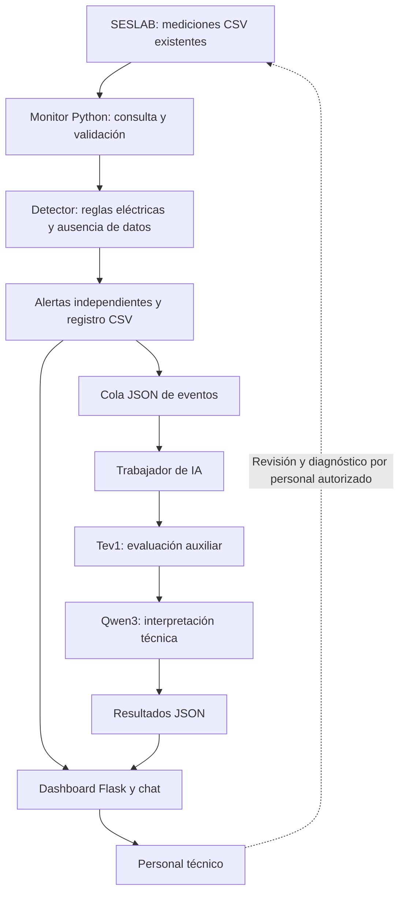

# Descripción general, objetivos y alcance — SolarCare AI

> **Fecha de referencia:** 11 de noviembre de 2026.  
> **Proyecto:** SolarCare AI — Sistema embebido inteligente para el análisis de anomalías fotovoltaicas.  
> **Integrantes:** Marycruz Fallas Barquero y Verónica Cambronero Solano.  
> **Institución:** Escuela de Ingeniería Electrónica, Instituto Tecnológico de Costa Rica (TEC).  
> **Contexto académico:** II Proyecto de Taller de Sistemas Embebidos.  
> **Documento base:** [Propuesta de diseño de SolarCare AI](../SolarCare_AI__propuesta_de_diseño_de_un_sistema_embebido_inteligente_para_el_análisis_de_anomalías_fotovoltaicas.pdf).  
> **Estado de este documento:** descripción de la propuesta original y del desarrollo disponible a la fecha; **no equivale a una certificación de funcionamiento integral en Raspberry Pi**.

## 1. Resumen del proyecto

**SolarCare AI** es una solución de monitoreo complementario para el Complejo Solar del TEC, orientada inicialmente a las mediciones del **inversor 2**. Su objetivo es transformar los registros eléctricos existentes en **eventos detectados automáticamente**, alertas almacenadas e interpretaciones técnicas que faciliten el análisis del personal encargado de la operación y el mantenimiento.

La solución combina:

- Algoritmos deterministas de **detección de anomalías** escritos en Python.
- Registro de eventos en un **CSV independiente** y publicación de tareas mediante archivos JSON.
- Un componente de **inteligencia artificial local** con Tev1 y Qwen3, servido mediante Ollama.
- Una **interfaz web Flask** para consultar mediciones, anomalías, análisis y un chat contextual.
- Una plataforma objetivo basada en **Raspberry Pi 4** y **Linux generado con Yocto Project**.

El sistema está concebido para **reutilizar los CSV del monitoreo existente**, sin reemplazar su plataforma ni modificar las mediciones originales. Las alertas son indicios que requieren revisión: **no constituyen por sí mismas diagnósticos físicos confirmados**.

**Estado actual:** el software de detección, procesamiento de eventos, inferencia y visualización ha sido desarrollado y probado localmente en Ubuntu. El equipo también reportó haber logrado conexión con la máquina virtual del SESLAB y visualizar CSV recientes, aunque con retraso. La compilación, el despliegue y el funcionamiento de toda la solución en Raspberry Pi con Yocto **todavía requieren evidencia documentada**.

## 2. Contexto del sistema existente

El Complejo Solar del TEC dispone de una infraestructura de monitoreo desarrollada previamente para la **adquisición, almacenamiento y presentación** de variables eléctricas de los inversores fotovoltaicos. La propuesta original identifica el trabajo de **Sánchez Solís** como antecedente de esta plataforma y registra observaciones técnicas de eventos de interés en el SESLAB.

Las mediciones se almacenan en archivos CSV que pueden contener, entre otros campos:

- Fecha y hora de actualización.
- Potencia de salida en corriente alterna (**AC output power**, W).
- Corriente de las **cuatro entradas CC** observadas (**DC current 1–4**, A).
- Tensión de las entradas CC cuando está disponible (**DC voltage 1–4**, V).

La plataforma ya permite consultar mediciones y gráficos, pero **disponer de los datos no implica identificar automáticamente los eventos anómalos que aparecen en ellos**.

### 2.1. Fuente y acceso a los datos

El diseño contempla la lectura autorizada de los CSV disponibles en una **máquina virtual** del entorno SESLAB, mediante una Raspberry Pi conectada a la infraestructura de red correspondiente.

El equipo informó que **ya consiguió conectarse a esa máquina virtual y visualizar archivos recientes conforme se actualizan**. Se observó también un **retraso entre la fecha de medición y la disponibilidad del dato en el CSV**.

La conexión comprobada **no acredita todavía**, sin un registro de prueba adicional, que el acceso se haya realizado desde la Raspberry Pi definitiva, que el detector lea automáticamente la carpeta remota o que se cumpla la restricción de solo lectura de manera verificable. Estas evidencias deben agregarse en la etapa de integración.

**Precaución de interpretación:** las cuatro entradas CC no deben describirse como cuatro MPPT o cuatro cadenas independientes mientras la topología física no esté confirmada.

## 3. Problema que se busca resolver

La revisión de las condiciones de funcionamiento fotovoltaico puede requerir que una persona examine registros históricos y recientes, compare magnitudes eléctricas, identifique intervalos anómalos y determine qué eventos ameritan atención.

Este enfoque presenta dificultades:

1. **Dependencia de la revisión manual:** una anomalía puede permanecer en los registros sin convertirse automáticamente en una alerta.
2. **Distintos tipos de anomalía:** una reducción de corriente CC, una caída de generación y la falta de mediciones **no representan necesariamente el mismo fenómeno**.
3. **Necesidad de confirmación temporal:** una muestra aislada no suele ser evidencia suficiente de una interrupción sostenida.
4. **Disponibilidad y retraso de los registros:** una falla de comunicación o un CSV desactualizado puede confundirse con una falla eléctrica si no se analiza por separado.
5. **Limitaciones del hardware embebido:** la interpretación mediante modelos locales debe convivir con restricciones de memoria, procesador y almacenamiento.

### 3.1. Definición sintética del problema

Se necesita **complementar la plataforma del SESLAB con una herramienta que procese automáticamente las mediciones, identifique comportamientos anómalos y organice evidencia técnica para facilitar su revisión**, preservando el sistema de adquisición existente y evitando que hipótesis de IA se presenten como fallas confirmadas.

## 4. Justificación técnica

El proyecto parte de una infraestructura real que **ya produce datos eléctricos**. Por eso, su aporte se concentra en **analizarlos y hacerlos más útiles** para labores de revisión, en vez de desarrollar un sistema nuevo de adquisición.

Las decisiones principales responden a esta justificación:

| Necesidad | Decisión técnica | Beneficio esperado |
| --- | --- | --- |
| Aprovechar el monitoreo existente | Lectura de CSV en modo de solo lectura | Reducir cambios en la infraestructura original |
| Detectar eventos repetibles y verificables | Reglas deterministas en Python | Facilitar pruebas y explicación de criterios |
| Evitar confundir interrupciones con huecos de datos | Algoritmos independientes para variables eléctricas y frescura de archivos | Mejorar la interpretación inicial |
| Mantener alertas aunque falle IA | Detector y trabajador desacoplados por una cola persistente | Continuidad del registro de eventos |
| Apoyar al personal sin afirmar causas | Tev1 y Qwen3 como interpretación complementaria | Organizar hipótesis y recomendaciones técnicas |
| Ejecutar el análisis cerca del origen | Raspberry Pi 4 y Linux personalizado con Yocto | Explorar una solución embebida administrable |
| Hacer accesibles resultados y evidencia | Dashboard Flask y chat contextual | Facilitar consulta de mediciones y anomalías |

La viabilidad, el desempeño y los beneficios esperados **deben demostrarse con pruebas**; esta tabla refleja razones de diseño y no métricas de mejora medidas.

## 5. Objetivos establecidos en la propuesta

Para conservar la trazabilidad académica, en esta sección se reproducen los **objetivos de la propuesta de diseño** sin modificar su alcance en función del avance actual.

### 5.1. Objetivo general

> Desarrollar un sistema embebido inteligente que automatice la detección de anomalías en las mediciones eléctricas del inversor 2 del Complejo Solar del Instituto Tecnológico de Costa Rica, mediante algoritmos de análisis de datos e inteligencia artificial local, con el propósito de facilitar la identificación de eventos anómalos y apoyar las actividades de mantenimiento del SESLAB.

### 5.2. Objetivos específicos

1. **Diseñar un mecanismo de adquisición y procesamiento de datos** que permita obtener y validar las mediciones eléctricas del inversor 2 a partir de los registros generados por la plataforma de monitoreo existente, sin modificar su funcionamiento.
2. **Implementar algoritmos de análisis de datos en Python** para detectar desviaciones en las corrientes de las entradas de corriente continua, interrupciones de generación y ausencia de mediciones, mediante criterios verificables utilizando registros históricos y escenarios de prueba.
3. **Integrar modelos de inteligencia artificial ejecutados localmente mediante Ollama** en una plataforma embebida con Linux generado mediante Yocto Project, para interpretar las anomalías detectadas, generar recomendaciones técnicas y verificar el funcionamiento del sistema mediante casos de prueba.

### 5.3. Interpretación del avance frente a los objetivos

| Objetivo | Evidencia disponible | Estado de cierre |
| --- | --- | --- |
| Objetivo específico 1 | Lectura y validación local de CSV; acceso a archivos recientes de la VM reportado por el equipo | **Parcial:** falta documentar el mecanismo automático autorizado desde la plataforma final |
| Objetivo específico 2 | Detector de interrupciones, reducciones de corriente y ausencia de datos; pruebas automatizadas en Ubuntu | **Avanzado en software:** requiere calibración y pruebas integrales con datos recientes |
| Objetivo específico 3 | Tev1 y Qwen3 utilizados en Ubuntu; recetas y servicios Yocto preparados | **Parcial:** falta demostrar la ejecución integrada, local y estable en Raspberry Pi |

En consecuencia, el **objetivo general no se declara todavía alcanzado por completo**, ya que incluye explícitamente un sistema **embebido** funcional.

## 6. Alcance y delimitaciones

### 6.1. Incluido en el alcance inicial

- Supervisión de las mediciones del **inversor 2**.
- Procesamiento de registros **CSV históricos y recientes** ya generados por el SESLAB.
- Dos vías de operación: **manual** (analizar un archivo) y **automática** (consultar periódicamente una fuente configurada).
- Identificación y registro de eventos eléctricos y de disponibilidad de datos.
- Generación de alertas en terminal y un **CSV independiente**.
- Interpretación local de eventos mediante modelos de IA y Ollama.
- Despliegue objetivo en Raspberry Pi con una imagen de Linux construida mediante Yocto.
- Pruebas unitarias, de integración y de aceptación sobre casos representativos.

### 6.2. Cuatro categorías de eventos definidas en el diseño

| Categoría | Qué significa | Estado actual de la implementación |
| --- | --- | --- |
| **Indisponibilidad de la aplicación web del SESLAB** | La web original no responde mientras los CSV se mantienen actualizados | **Pendiente:** RF-06/RF-07; existe el tipo de evento en el agente, no su detección automática |
| **Ausencia de nuevas mediciones** | Las marcas temporales no avanzan dentro del umbral de supervisión | **Implementada localmente**, con umbral provisional y pruebas |
| **Posible interrupción de generación** | La potencia cae durante un período de generación esperada; se consideran eventos sostenidos y transitorios | **Implementada localmente**; calibración y prueba integrada pendientes |
| **Reducción sostenida de corriente CC** | Una entrada registra una reducción frente a su propia referencia reciente, con confirmación temporal | **Implementada localmente**; topología y umbrales por verificar |

Una alerta de cualquiera de estas categorías **no demuestra por sí misma una falla física**.

### 6.3. Fuera del alcance inicial

- Sustituir o modificar la plataforma original de adquisición y la web de monitoreo del SESLAB.
- Controlar inversores, abrir o cerrar circuitos, cambiar parámetros operativos o manipular equipos eléctricos.
- Diagnosticar de manera concluyente una falla física sin inspección ni evidencia adicional.
- Supervisar automáticamente los ocho inversores desde la primera entrega; el **inversor 2** es el caso inicial.
- Reconstruir series completas de datos faltantes o realizar predicción avanzada de degradación.
- Garantizar datos en **tiempo real estricto** o latencia constante pese al retraso observado de los CSV.
- Publicar datos originales institucionales, contraseñas, direcciones IP privadas o pesos voluminosos de modelos en el repositorio.

### 6.4. Ampliación desarrollada respecto de la propuesta

Durante la implementación se agregó un **dashboard web Flask** con selección de fecha, gráficas de potencia, historial de alertas, presentación de resultados de Tev1/Qwen3 y **chat contextual con Qwen3**.

Esta interfaz **amplía la facilidad de consulta**, pero es un componente independiente: su funcionamiento local en Ubuntu no equivale todavía a que esté empaquetada y operativa dentro de la imagen Yocto. Tampoco reemplaza la web original del SESLAB.

## 7. Actores y responsabilidades del sistema

| Actor o componente | Rol |
| --- | --- |
| **Personal técnico del SESLAB** | Consultar anomalías, contrastar evidencias y decidir revisiones seguras; conserva la responsabilidad del diagnóstico |
| **Sistema de adquisición del SESLAB** | Generar y almacenar las mediciones originales |
| **SolarCare AI — monitor y detector** | Leer los datos, aplicar reglas y registrar eventos |
| **SolarCare AI — trabajador y agente de IA** | Interpretar los eventos disponibles, sin modificar la detección ni controlar equipos |
| **SolarCare AI — dashboard** | Presentar mediciones, alertas e interpretaciones y atender consultas contextuales |
| **Equipo del proyecto** | Desarrollar, integrar, probar y documentar el sistema |

La separación de responsabilidades evita presentar los modelos generativos como autoridades de control o de diagnóstico físico.

## 8. Funcionamiento conceptual del sistema

### 8.1. Flujo principal



**Interpretación del diagrama:** describe el objetivo funcional y la estructura del software; la operación **extremo a extremo en Yocto** todavía debe comprobarse con evidencia de hardware.

### 8.2. Casos de uso esperados

- **Supervisión automática:** detectar cambios en CSV, validar mediciones, evaluar anomalías y registrar eventos cuando se confirmen.
- **Análisis manual:** seleccionar un CSV histórico para revisar o reproducir situaciones de interés.
- **Consulta de alertas:** examinar los eventos registrados con sus fechas y magnitudes.
- **Interpretación asistida:** obtener la puntuación de Tev1 y las hipótesis/recomendación de Qwen3, cuando Ollama esté disponible.
- **Consulta web:** visualizar tendencias y preguntar a Qwen3 por la evidencia del evento seleccionado.

Si la IA falla, el diseño exige conservar la **detección y el registro**. El trabajador debe mantener los eventos pendientes para poder reintentarlos.

## 9. Tecnologías y estructura del repositorio

| Tecnología | Aplicación en SolarCare AI |
| --- | --- |
| **Python 3** | Lectura de CSV, validación, algoritmos de detección, publicación y procesamiento de eventos |
| **pytest** | Pruebas unitarias y de integración en Ubuntu |
| **Ollama** | Ejecución de los modelos localmente |
| **Tev1 0.8B** | Evaluación auxiliar estructurada de la necesidad de revisión |
| **Qwen3 1.7B** | Interpretación de anomalías y conversación contextual |
| **Flask + HTML/CSS/JavaScript** | Dashboard web de consulta |
| **Yocto Project / BitBake** | Construcción de la imagen Linux y empaquetado de componentes |
| **systemd** | Servicios y temporizador en el entorno Linux embebido |
| **Git y GitHub** | Versionado, revisión por pull request y documentación técnica |

Estructura documental y de software disponible en la rama de trabajo:

```text
Project_2_Embebidos/
├── README.md
├── docs/
│   ├── README.md
│   ├── 01_descripcion_del_proyecto.md
│   ├── 02_matriz_requerimientos.md
│   ├── 03_arquitectura_del_sistema.md
│   ├── 04_implementacion_del_detector.md
│   ├── 05_integracion_inteligencia_artificial.md
│   ├── 06_interfaz_grafica.md
│   ├── 07_integracion_yocto.md
│   ├── 08_pruebas_y_validacion.md
│   ├── 09_resultados_y_limitaciones.md
│   └── evidencias/
│       └── plantilla_registro_prueba.md
├── software/
│   ├── solarcare/                 # Programas Python del detector y agente
│   ├── interfaz_solarcare_v2/    # Flask, HTML, CSS y JavaScript
│   └── tests/                    # Cinco archivos de pruebas
└── yocto/
    └── meta-solarcare/           # Recetas e imagen embebida
```

La rama de Verónica, `feature/solarcare-integracion`, mantiene además los programas que está incorporando al entorno Yocto; todavía es necesario **comprobar que el código empaquetado corresponde a la versión revisada** y que la interfaz quede instalada dentro de la imagen.

## 10. Estado de implementación y evidencias

A la fecha de referencia, la [matriz de trazabilidad](02_matriz_requerimientos.md) clasifica los **24 requisitos originales**:

| Estado | Cantidad |
| --- | ---: |
| **Implementado y probado localmente en Ubuntu** | **14** |
| **Parcialmente cubierto** | **6** |
| **Pendiente** | **4** |
| **Total** | **24** |

Se ejecutó un conjunto de **39 pruebas automatizadas aprobadas en Ubuntu** cuando se contó con tres CSV históricos locales no distribuidos en GitHub. En un clon sin esos archivos, **tres casos se omiten**; ese detalle está documentado en [08_pruebas_y_validacion.md](08_pruebas_y_validacion.md).

El sistema de IA y la interfaz también se probaron manualmente en Ubuntu; el registro formal de sus entradas, salidas y tiempos debe completarse. El acceso a CSV recientes de la VM fue reportado por el equipo, pero aún requiere documentar el procedimiento y la latencia.

**Estos resultados no equivalen a un porcentaje formal de aceptación del sistema embebido.** Las pruebas finales con Raspberry Pi, Yocto, servicios, modelos y datos accesibles son necesarias para cerrar el objetivo general.

## 11. Entregables y criterios de cierre

La documentación final del proyecto deberá permitir rastrear:

1. **Requerimientos:** identificador, implementación y evidencia de aceptación.
2. **Arquitectura:** componentes, interfaces, rutas y decisiones justificadas.
3. **Detector:** algoritmo, umbrales, casos confirmados y límites de interpretación.
4. **Agente IA:** contratos de entrada/salida, fallos, reintentos y uso de recursos.
5. **Interfaz:** fuentes de datos, visualización, chat y protección del acceso.
6. **Yocto:** recetas, imagen, servicios, almacenamiento y procedimiento reproducible.
7. **Validación:** pruebas ejecutadas, logs, capturas, métricas y limitaciones.
8. **Resultados:** correspondencia entre lo diseñado, lo implementado y lo realmente demostrado.

Para considerar concluida la integración es necesario adjuntar evidencia de **arranque de la imagen**, **acceso autorizado desde Raspberry Pi a CSV**, **detección y registro**, **procesamiento con modelos locales**, **interfaz disponible en el entorno de uso previsto** y **consumo de recursos dentro de límites aceptables**.

El [plan de pruebas](08_pruebas_y_validacion.md) y la [plantilla de evidencias](evidencias/plantilla_registro_prueba.md) describen cómo registrar esos resultados.

## 12. Lectura recomendada de la documentación

| Orden | Documento | Qué explica |
| --- | --- | --- |
| **01** | Este documento | Contexto, problema, justificación, objetivos y alcance |
| **02** | [Matriz de requerimientos](02_matriz_requerimientos.md) | Cobertura individual de los 16 RF y 8 RNF |
| **03** | [Arquitectura](03_arquitectura_del_sistema.md) | Diagrama de componentes, interfaces y decisiones de diseño |
| **04** | [Detector](04_implementacion_del_detector.md) | Reglas, validación de CSV y detección de anomalías |
| **05** | [IA](05_integracion_inteligencia_artificial.md) | Tev1, Qwen3, Ollama, cola y recuperación |
| **06** | [Interfaz](06_interfaz_grafica.md) | Flask, visualización y chat |
| **07** | [Yocto](07_integracion_yocto.md) | Imagen Linux, servicios, persistencia e integración |
| **08** | [Pruebas](08_pruebas_y_validacion.md) | Casos automatizados y plan de aceptación embebida |
| **09** | [Resultados](09_resultados_y_limitaciones.md) | Hallazgos, limitaciones y conclusiones preliminares |

**Criterio de seguridad y honestidad técnica:** no publicar información institucional de acceso restringido ni marcar como aprobadas pruebas que carezcan de resultado observado. Este documento se actualizará cuando exista nueva evidencia validada.

---

**Referencias internas:** [Propuesta original (PDF)](../SolarCare_AI__propuesta_de_diseño_de_un_sistema_embebido_inteligente_para_el_análisis_de_anomalías_fotovoltaicas.pdf) · [Índice general](README.md) · [Pruebas y validación](08_pruebas_y_validacion.md).
