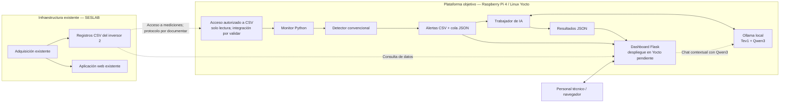
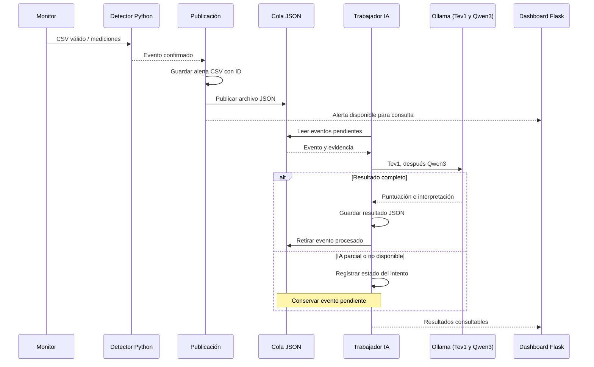

# Arquitectura del sistema SolarCare AI

> **Versión documental:** 12 de noviembre de 2026.  
> **Referencia de diseño:** propuesta *SolarCare AI: propuesta de diseño de un sistema embebido inteligente para el análisis de anomalías fotovoltaicas*, apartados V (vista operacional), VI (vista funcional), VII (arquitectura), VIII (dependencias) y IX (integración).  
> **Alcance de esta descripción:** código publicado en `feature/solarcare-python-dashboard`; integración Yocto en desarrollo en `feature/solarcare-integracion`. Se distingue explícitamente entre implementación, pruebas Ubuntu y validación embebida pendiente.

## 1. Propósito y límites del sistema

SolarCare AI complementa el monitoreo fotovoltaico existente del SESLAB del Instituto Tecnológico de Costa Rica. Analiza registros CSV del **inversor 2** y produce alertas, evidencia estructurada e interpretaciones técnicas para apoyar la revisión del personal encargado.

SolarCare AI **no reemplaza** la aplicación del SESLAB, **no modifica los archivos de medición originales** y **no ejecuta control sobre los inversores**. Una anomalía detectada es un evento que requiere evaluación; no equivale por sí mismo a una falla física confirmada.

El principio arquitectónico central es la separación entre **detección determinista** y **procesamiento con IA**: si Ollama o un modelo dejan de responder, las alertas pueden seguir registrándose y conservarse para un análisis posterior.

## 2. Vista física y de despliegue

El diseño contempla dos entornos:

1. **Infraestructura existente del SESLAB:** máquina virtual que aloja la aplicación web de monitoreo y archivos CSV generados por el sistema de adquisición.
2. **Plataforma SolarCare AI:** Raspberry Pi 4 con Linux construido mediante Yocto, encargada del análisis, almacenamiento de resultados y ejecución local de modelos.

El equipo reportó **haber establecido comunicación con la máquina virtual y visualizado CSV recientes con cierto retraso**. Esa observación confirma acceso a los datos desde el entorno utilizado en la prueba, pero aún hay que documentar desde qué equipo se conectaron, cómo se montó o consultó la carpeta y cómo se incorpora el acceso al servicio que correrá en Raspberry Pi.

**Nota sobre el diagrama:** representa la arquitectura objetivo y las conexiones lógicas; no afirma que todas las flechas estén ya verificadas en Raspberry Pi. El dashboard está probado en Ubuntu, pero no consta instalado en la receta Yocto revisada.

## 3. Vista lógica y responsabilidades

| Capa | Componentes del repositorio | Responsabilidad | Estado |
| --- | --- | --- | --- |
| Fuente de información | CSV generados por la infraestructura SESLAB | Proporcionar mediciones con fecha/hora, potencia AC y variables CC | Acceso a datos recientes reportado; integración automática aún por evidenciar |
| Monitoreo periódico | [monitor_diario_solarcare.py](../software/solarcare/monitor_diario_solarcare.py), [monitorear_csv_solarcare.py](../software/solarcare/monitorear_csv_solarcare.py) | Identificar cambios en el archivo, consultar periódicamente y disparar el análisis | Implementado y probado localmente |
| Disponibilidad de datos | [detectar_ausencia_datos.py](../software/solarcare/detectar_ausencia_datos.py), [eventos_ausencia_solarcare.py](../software/solarcare/eventos_ausencia_solarcare.py), [seguimiento_estado_datos.py](../software/solarcare/seguimiento_estado_datos.py) | Detectar CSV faltantes o desactualizados y conservar estado de ausencia/recuperación | Implementado y probado localmente |
| Detección eléctrica | [detector_solarcare.py](../software/solarcare/detector_solarcare.py) | Validar mediciones y detectar interrupciones de generación y caídas sostenidas de corriente CC | Implementado y probado localmente |
| Publicación | [puente_detector_ia.py](../software/solarcare/puente_detector_ia.py), [publicacion_unica.py](../software/solarcare/publicacion_unica.py) | Almacenar alerta, asignar ID, evitar duplicados y colocar eventos en cola | Implementado y probado localmente |
| Procesamiento asíncrono | [trabajador_ia.py](../software/solarcare/trabajador_ia.py) | Consumir eventos pendientes, almacenar resultados y conservar pendientes si falla IA | Implementado y probado localmente |
| Interpretación | [agente_solarcare.py](../software/solarcare/agente_solarcare.py) | Coordinar Tev1 y Qwen3 mediante Ollama, validar formato y emitir recomendaciones | Probado en Ubuntu; pendiente Raspberry Pi |
| Presentación | [interfaz_solarcare_v2](../software/interfaz_solarcare_v2/README.md) | Mostrar mediciones, alertas, resultados y chat contextual | Probado en Ubuntu; despliegue en Yocto pendiente |
| Plataforma embebida | [yocto/meta-solarcare](../yocto/meta-solarcare) | Construir imagen y gestionar procesos con systemd | Recetas y servicios disponibles; funcionamiento integral pendiente |

### 3.1. Monitoreo y lectura

El monitor localiza el CSV esperado según la fecha, utilizando la estructura `YYYY-MM-DD/YYYY-MM-DD.csv` bajo una raíz configurable. En modo `--continuo`, consulta periódicamente la existencia y versión del archivo, definida por su tamaño y marca de modificación. Si encuentra cambios, invoca el análisis.

`detector_solarcare.leer_csv()` abre el archivo en modo lectura, exige encabezados obligatorios, comprueba valores eléctricos finitos y no negativos y verifica el orden creciente de las marcas temporales.

**Límite:** detectar que cambió un archivo y deduplicar alertas **no equivale** a mantener una bitácora individual de cada fila procesada. Este matiz está reflejado en RF-03 de la [matriz de trazabilidad](02_matriz_requerimientos.md).

### 3.2. Detección de anomalías

Los algoritmos principales son reglas explícitas en Python, independientes de Ollama:

- **Interrupción sostenida de generación:** caída a potencia baja dentro de un horario esperado, con generación previa y duración mínima de confirmación.
- **Interrupción transitoria:** medición puntual de potencia y corriente próximas a cero entre muestras con generación, con recuperación posterior y tensión CC disponible. La duración registrada se trata como **cota superior**, no duración exacta.
- **Reducción sostenida de corriente CC:** cada una de las cuatro entradas se compara con su propia mediana reciente; se exige confirmación temporal y corroboración mediante otras entradas relativamente estables.
- **Ausencia de datos:** evaluación independiente de la frescura de las marcas temporales y del archivo esperado.

Los valores y ventanas del detector son **parámetros iniciales de prueba**, todavía sujetos a calibración con datos reales. La reducción de corriente por sí sola no identifica la causa física. La naturaleza exacta de las cuatro entradas CC (cadenas, agrupaciones o MPPT) requiere confirmación técnica.

**Categoría prevista pero no implementada en el monitor:** indisponibilidad de la aplicación web original del SESLAB con CSV actualizados. Aunque el agente de IA admite ese tipo de evento, todavía no se identificó un verificador HTTP que lo genere (RF-06 y RF-07).

### 3.3. Registro, cola y desacoplamiento

El publicador genera un registro en `alertas_anomalias.csv` **antes** de intentar la comunicación con el trabajador de IA. La alerta contiene un identificador único, instante de registro, categoría, inversor y datos del evento serializados en JSON. Luego se crea un archivo JSON en `cola_ia/`.

El mecanismo de publicación única utiliza los campos `inversor`, `evento`, `subtipo`, `entrada_cc` e `inicio_evento` como clave lógica, junto con un bloqueo de archivo para evitar registros duplicados por ejecuciones concurrentes.

El trabajador lee los archivos `cola_ia/*.json`, solicita el análisis y guarda `resultados_ia/<id_evento>.json`. El evento se retira de la cola **solo si** el resultado está completo; si la IA falla o la salida es parcial, permanece pendiente para un reintento. Los eventos estructuralmente inválidos se separan cuando corresponde.

El diagrama es una **secuencia lógica**: el dashboard consulta archivos y servicios, no recibe necesariamente notificaciones directas de los demás componentes.

### 3.4. Tev1, Qwen3 y Ollama

El agente define dos modelos complementarios:

- **Sistema 1 — `tev1:0.8b`:** llamado a `/v1/systemone`; devuelve una `puntuacion_revision` entre 0 y 1 para apoyar la priorización. Esta puntuación no debe presentarse como probabilidad de falla física; la salida actual tampoco proporciona todavía la categoría y prioridad explícitas exigidas por RF-15.
- **Sistema 2 — `qwen3:1.7b`:** genera una explicación, tres hipótesis y una recomendación de revisión a partir del evento detectado. La respuesta se valida estructuralmente, pero su formato válido **no garantiza exactitud técnica**.

La ejecución es secuencial y utiliza `keep_alive=0` para favorecer la descarga de los modelos tras responder, sujeto a verificación de recursos en Raspberry Pi.

El agente requiere **el servidor Ollama** y también el **paquete Python `ollama`** para la llamada del Sistema 2. Es necesario verificar su instalación en la imagen final.

### 3.5. Dashboard web y chat

La interfaz basada en Flask presenta mediciones, gráficos, alertas y resultados de IA. Las rutas identificadas en [app.py](../software/interfaz_solarcare_v2/app.py) son:

| Método y ruta | Responsabilidad |
| --- | --- |
| `GET /` | Presentar el dashboard HTML |
| `GET /api/estado` | Proporcionar el estado y datos disponibles para la interfaz |
| `POST /api/chat` | Enviar una consulta contextual a Qwen3 mediante Ollama |

Configuración disponible: `SOLARCARE_SALIDAS`, `SOLARCARE_CSV`, `SOLARCARE_CSV_RAIZ`, `SOLARCARE_OLLAMA_URL`, `SOLARCARE_CHAT_MODEL` y `SOLARCARE_PORT`.

**Importante para la integración:** el directorio de alertas del backend, por defecto, se crea junto a los módulos Python; el dashboard utiliza otra ruta por defecto. Debe configurarse **el mismo directorio de salidas**, por ejemplo mediante `SOLARCARE_SALIDAS`, para que la visualización encuentre los eventos reales.

La aplicación muestra un modo de demostración cuando no existen datos; esto **no confirma que el inversor esté generando**. Tampoco hay que inferir frescura de datos únicamente porque un CSV sea accesible. El chat no modifica archivos ni opera equipos.

El servidor Flask incluido usa una dirección de loopback para las pruebas locales; para acceso desde otra máquina o despliegue embebido será necesario un servidor apropiado, configuración de red y controles de acceso. **No se debe exponer Ollama directamente a redes no autorizadas.**

## 4. Implementación embebida con Yocto

En la rama `feature/solarcare-integracion` se observaron estos recursos, todavía **no incorporados a `main`** en la última revisión:

| Recurso de Yocto | Comportamiento previsto |
| --- | --- |
| `recipes-apps/solarcare/solarcare_1.0.bb` | Copiar los programas Python a `/opt/solarcare`, instalar unidades de systemd y disponer de almacenamiento de salida |
| `solarcare-detector.service` | Ejecutar el monitor en modo continuo con consultas cada 10 segundos, verificación de datos y publicación de eventos |
| `solarcare-agent.service` | Ejecutar una pasada del trabajador de IA mediante un servicio `oneshot` |
| `solarcare-agent.timer` | Programar el trabajador tras el arranque y después de cada ejecución |
| `recipes-core/images/solarcare-image.bb` | Construir la imagen con paquetes necesarios para Python, SolarCare, Ollama y otros componentes |

La receta revisada indica `SYSTEMD_AUTO_ENABLE = "disable"`: hay que verificar su habilitación efectiva para la demostración. La interfaz Flask **no figura todavía instalada** en la receta de aplicación inspeccionada.

La imagen, los servicios y los modelos todavía requieren una **prueba de extremo a extremo sobre Raspberry Pi** que demuestre: lectura de datos, detección, escritura persistente, proceso de cola, Ollama y consulta desde el navegador.

## 5. Interfaces y rutas de datos

| Interfaz | Entrada | Salida / destino | Restricción |
| --- | --- | --- | --- |
| Fuente SESLAB → monitor | CSV y marcas temporales | Registros validados en memoria | Acceso autorizado y exclusivamente de lectura; mecanismo remoto pendiente de documentar |
| Monitor → detector | Lista de mediciones | Eventos eléctricos y estados de disponibilidad | Tolerancia a CSV incompletos mientras se actualizan |
| Publicador → almacenamiento | Evento confirmado | `alertas_anomalias.csv` | Independiente de los CSV originales |
| Publicador → trabajador | JSON de evento en `cola_ia/` | Resultado en `resultados_ia/` | Reintentos sin pérdida de la alerta |
| Trabajador → Ollama | Evento, evidencias y consulta técnica | Puntuación e interpretación | La detección sigue sin IA |
| Flask → archivos / Ollama | CSV, alertas, resultados y pregunta del usuario | Respuesta HTTP/JSON para el navegador | No interpretar datos locales como telemetría en vivo |

**Rutas de integración Yocto planteadas:** origen de datos bajo `/var/lib/solarcare/datos/Inversor 2`, salidas bajo `/var/lib/solarcare/salidas` y aplicación en `/opt/solarcare`. Estas son rutas de la configuración publicada por Verónica, **no evidencia de que ya exista el montaje en la Raspberry Pi**.

La consulta de CSV recientes tiene un retraso observado respecto a las mediciones originales. Todavía no se dispone de una serie de mediciones del retraso que permita afirmar una latencia constante. Los tiempos de consulta y los umbrales de ausencia deben calibrarse tomando en cuenta esta característica.

## 6. Decisiones de diseño y justificación

| Decisión | Justificación técnica | Consecuencia / verificación |
| --- | --- | --- |
| Aprovechar la infraestructura del SESLAB | Evita duplicar adquisición y sustituir la plataforma existente | Requiere conexión remota segura y no invasiva |
| Detector Python sin IA | Reglas reproducibles, trazables y verificables | El detector puede seguir registrando eventos aunque falle Ollama |
| Cola persistente de archivos JSON | Desacopla tiempos de detección e inferencia | Reintentos; vigilar permisos, espacio y archivos pendientes |
| CSV de alertas separado | Conserva fuente de mediciones e historial de eventos | Verificar integridad y persistencia |
| Dos modelos con funciones diferenciadas | Separación entre evaluación estructurada e interpretación técnica | Medir latencia y memoria para decidir viabilidad en RPi |
| Flask como componente de presentación | Permite consultar datos, eventos y análisis desde navegador | Integración, seguridad y servidor de producción pendientes |
| Linux personalizado con Yocto | Control de paquetes, servicios y despliegue reproducible | Confirmar dependencias, build y arranque real |

## 7. Validación, riesgos y asuntos abiertos

Las pruebas unitarias y de integración del software en Ubuntu registraron **39 casos aprobados** con el conjunto de CSV históricos local disponible. Estas pruebas no acreditan la operación integral en Raspberry Pi ni todas las condiciones reales de adquisición.

**Pruebas y evidencias necesarias para cerrar la arquitectura:**

1. **Conectividad y origen:** documentar equipo de prueba, mecanismo autorizado de acceso a VM, lectura sin modificaciones y latencia medida de los CSV. No publicar IP privadas ni credenciales.
2. **Ejecución en Raspberry Pi:** adjuntar versiones de imagen, recetas, estado de servicios y evidencia del flujo automático completo.
3. **Persistencia y rutas:** verificar que el monitor, la cola, el trabajador y Flask utilicen los directorios correctos y que los registros sobrevivan a reinicios.
4. **Recursos de IA:** medir RAM, CPU, tiempo de inferencia Tev1/Qwen3 y respuesta del sistema cuando Ollama falla.
5. **Trazabilidad:** completar RF-06/RF-07 (disponibilidad de web), RF-15 (salida exigida), RNF-01 (hashes), RNF-04 (registro persistente de errores) y RNF-05 (configuración externa).
6. **Presentación y seguridad:** definir si Flask se incorpora a Yocto y cómo se servirá de manera controlada; no exponer interfaces ni modelos públicamente.

Véase también la [matriz de requerimientos](02_matriz_requerimientos.md) para el estado individual de los 24 requisitos.

## 8. Documentación y código fuente

- Propuesta original: PDF de diseño en la raíz del repositorio.
- [Código de SolarCare AI](../software/solarcare/)
- [Pruebas automatizadas](../software/tests/)
- [Dashboard Flask](../software/interfaz_solarcare_v2/)
- [Capa Yocto](../yocto/meta-solarcare/) en `main` (la integración ampliada se revisó en una rama separada).

**Criterio editorial:** actualizar las afirmaciones de «pendiente» solo cuando exista evidencia reproducible del requisito y del entorno en que se ejecutó.
