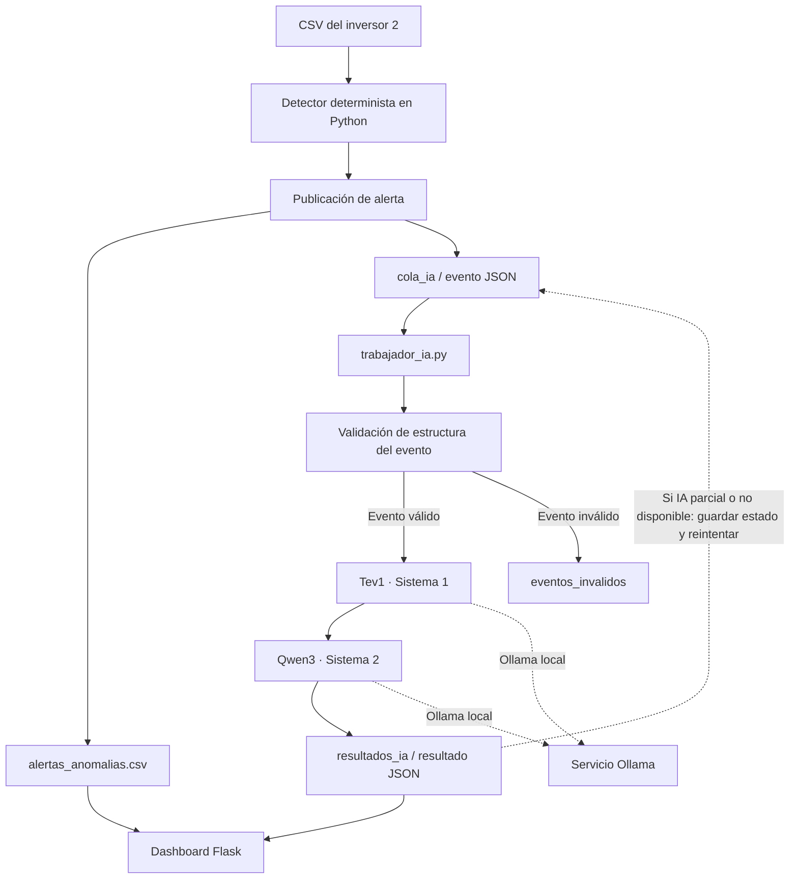
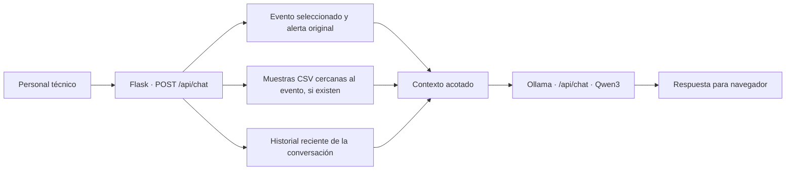

# Integración de inteligencia artificial — SolarCare AI

> **Documento técnico:** implementación de Tev1 y Qwen3 mediante Ollama, procesamiento desacoplado y chat contextual.  
> **Código revisado:** rama `feature/solarcare-python-dashboard`. Se consideran además los servicios publicados por Verónica en `feature/solarcare-integracion`.  
> **Estado:** los modelos han sido utilizados localmente en Ubuntu; **la inferencia integrada en Raspberry Pi con Yocto todavía requiere validación documentada**.

## 1. Propósito de la inteligencia artificial

SolarCare AI utiliza inteligencia artificial como **apoyo a la revisión técnica** de eventos previamente detectados por algoritmos convencionales. El agente no sustituye al detector, no confirma por sí mismo fallas físicas y no controla los inversores.

La propuesta de diseño estableció dos componentes complementarios:

- **Sistema 1 — Tev1 (`tev1:0.8b`):** evaluación estructurada de la necesidad de revisión de un evento.
- **Sistema 2 — Qwen3 (`qwen3:1.7b`):** interpretación técnica del evento, formulación de hipótesis y recomendación de comprobaciones seguras.

Ambos modelos se invocan mediante **Ollama**, ejecutado como servicio local. El objetivo de esta separación es preservar la independencia de la detección y evitar que las respuestas generativas se utilicen como prueba de una causa física.

**Distinción de responsabilidades:** Python establece el evento y sus mediciones; Tev1 devuelve una evaluación auxiliar; Qwen3 explica el significado técnico posible de la evidencia. El personal autorizado realiza cualquier diagnóstico o intervención física.

## 2. Arquitectura de procesamiento



**Nota:** se presenta el flujo lógico de la implementación. La ejecución periódica mediante `systemd` se ha preparado en una rama de integración, pero no constituye todavía una demostración de funcionamiento completo en Raspberry Pi. El chat del dashboard utiliza una **ruta distinta** hacia Qwen3, explicada en el apartado 7.

| Componente | Archivo | Responsabilidad |
| --- | --- | --- |
| Detector | [`detector_solarcare.py`](../software/solarcare/detector_solarcare.py) | Reconocer eventos con criterios eléctricos y temporales; no depende de Ollama. |
| Publicación | [`puente_detector_ia.py`](../software/solarcare/puente_detector_ia.py) | Guardar primero la alerta y luego encolar el evento. |
| Control de duplicados | [`publicacion_unica.py`](../software/solarcare/publicacion_unica.py) | Evitar crear alertas repetidas para la misma clave de evento. |
| Trabajador | [`trabajador_ia.py`](../software/solarcare/trabajador_ia.py) | Procesar una pasada de la cola y guardar el resultado. |
| Agente | [`agente_solarcare.py`](../software/solarcare/agente_solarcare.py) | Validar el evento, llamar a Tev1 y Qwen3, y devolver el estado. |
| Visualización y chat | [`interfaz_solarcare_v2/app.py`](../software/interfaz_solarcare_v2/app.py) | Consultar los resultados e interactuar con Qwen3 mediante una ruta HTTP adicional. |

## 3. Sistema 1: evaluación estructurada mediante Tev1

La función [`consultar_tev1(evento)`](../software/solarcare/agente_solarcare.py) envía una solicitud HTTP a:

- **Servicio local:** `http://127.0.0.1:11434` (configuración del agente).
- **Ruta:** `POST /v1/systemone`.
- **Modelo solicitado:** `tev1:0.8b`.
- **Formato de pregunta:** tipo `noul`, con la instrucción «Does this detected event warrant technical review?».

El campo `state` contiene el diccionario del evento calculado por el detector. Del resultado se extrae `answers.requiere_revision.noul`.

La aplicación exige que la respuesta sea un número **finito entre 0 y 1**; en otro caso, o si falla la comunicación, la función devuelve `None` y no detiene el detector.

### 3.1. Significado y alcance de la puntuación

La variable `puntuacion_revision` es una **evaluación auxiliar de conveniencia de revisión técnica**. No se encuentra calibrada como:

- Probabilidad estadística de falla del inversor.
- Probabilidad de una causa física concreta.
- Índice de gravedad eléctrica verificado.
- Confirmación de un diagnóstico.

**Diferencia respecto de RF-15:** la propuesta exige una **categoría y una prioridad válidas** por evento. El agente publicado obtiene actualmente **una puntuación numérica**, pero **no asigna explícitamente ambos campos**. Por ello, RF-15 permanece **parcialmente cumplido** hasta completar la transformación verificable o acordar formalmente una modificación del criterio.

### 3.2. Relación con Jev

La propuesta menciona la tecnología **Jev** como referencia para evaluación estructurada. La implementación utiliza una API `/v1/systemone` descrita en el código como compatible con Jev. **La utilización de esta interfaz no demuestra por sí sola que exista una instalación independiente de Jev**: la dependencia efectiva que se debe comprobar es el modelo Tev1 servido por Ollama y la disponibilidad de la ruta requerida.

## 4. Sistema 2: interpretación técnica con Qwen3

La función [`consultar_qwen(evento, puntuacion)`](../software/solarcare/agente_solarcare.py) crea un cliente Python de Ollama y ejecuta `qwen3:1.7b` **después** de la consulta a Tev1.

El contexto de entrada contiene dos elementos:

1. **Evento:** categoría, inversor, instante, magnitudes eléctricas y demás evidencia reportada por el detector.
2. **Puntuación de Tev1:** disponible o `null` si el Sistema 1 no pudo responder.

La llamada de la implementación utiliza, entre otras opciones:

| Ajuste | Valor en el agente | Finalidad |
| --- | --- | --- |
| Modelo | `qwen3:1.7b` | Interpretación técnica del evento. |
| `format` | `json` | Solicitar respuesta estructurada. |
| `think` | `False` | Evitar una salida adicional de razonamiento en la respuesta. |
| `temperature` | `0` | Reducir variabilidad de las respuestas. |
| `keep_alive` | `0` | Solicitar descarga del modelo tras la respuesta. |
| Tiempo de espera del agente | `120 s` | Límite configurado para comunicación con Ollama. |

### 4.1. Estructura exigida en la salida

El modelo debe entregar un objeto JSON con:

| Campo | Tipo esperado | Significado |
| --- | --- | --- |
| `explicacion` | Texto no vacío | Descripción técnica del evento con apoyo en sus mediciones. |
| `posibles_causas` | Lista de **exactamente tres** textos no vacíos | Hipótesis de análisis, no causas confirmadas. |
| `recomendacion` | Texto no vacío | Revisión propuesta para personal autorizado. |

El agente comprueba estos tipos y campos **antes de aceptar la respuesta**. Esta validación verifica **estructura**, pero **no garantiza que cada hipótesis o explicación sea técnicamente correcta**.

### 4.2. Instrucciones diferenciadas según el evento

La aplicación añade reglas al mensaje de sistema de Qwen3 según el tipo de evento:

- **`ausencia_datos`:** distinguir fallos de adquisición, comunicación o almacenamiento frente a una interrupción eléctrica real.
- **`interrupcion_generacion`:** diferenciar hechos observados de hipótesis como condiciones de irradiancia, protecciones o alarmas del inversor; ninguna se declara confirmada.
- **`reduccion_corriente_dc`:** identificar la entrada CC afectada sin equipararla automáticamente con un MPPT individual ni con una falla general del inversor.
- **`indisponibilidad_web`:** orientar las hipótesis hacia la aplicación de monitoreo, su conectividad o su configuración, y no hacia una falla física sin evidencia.

**Limitación:** el agente puede interpretar `indisponibilidad_web` **si recibe un evento válido de esa categoría**, pero el software de monitoreo todavía no implementa la comprobación HTTP y la correlación que lo generarían automáticamente (RF-06/RF-07).

### 4.3. Tratamiento especial de eventos transitorios

Para `interrupcion_generacion` con `subtipo="transitoria"`, el agente:

1. Indica a Qwen3 que `inicio_evento` es la **primera muestra anómala**, no necesariamente el instante físico exacto del inicio.
2. Aclara que `recuperacion_observada` indica la primera muestra posterior con generación.
3. Trata `duracion_maxima_minutos` como una **cota superior entre mediciones**.
4. Sustituye la explicación generada por Qwen3 con una descripción construida programáticamente a partir de potencias, corrientes, tensiones y marcas de tiempo registradas.

Esta última decisión ayuda a mantener la **descripción factual del transitorio anclada en los valores del detector**, incluso cuando las hipótesis y recomendaciones continúan siendo generativas.

Para otros eventos sostenidos se informa que la duración disponible corresponde al **tiempo observado hasta la confirmación**, no necesariamente a la duración total de la anomalía.

## 5. Coordinación de ambos modelos

La función [`analizar_evento(evento)`](../software/solarcare/agente_solarcare.py) sigue esta secuencia:

1. Ejecuta `validar_evento()` para verificar categoría, campos requeridos, tipos y coherencia básica.
2. Si el evento es inválido, devuelve `estado_ia="evento_invalido"` sin consultar a los modelos.
3. Si es válido, llama **primero a Tev1**.
4. A continuación, llama **a Qwen3 incluso si Tev1 falló**, pasando `None` como puntuación.
5. Devuelve las respuestas disponibles y el estado global de interpretación.

| `estado_ia` | Condición | Consecuencia |
| --- | --- | --- |
| `completo` | Tev1 devolvió puntuación y Qwen3 devolvió interpretación válida. | Se guarda el resultado y el trabajador retira el evento de la cola. |
| `parcial` | Respondió solo uno de los dos componentes. | Se guarda el estado parcial y el evento queda pendiente de reintento. |
| `no_disponible` | Ninguno produjo resultado utilizable o el trabajador capturó una excepción. | La alerta original se conserva y el evento permanece en cola. |
| `evento_invalido` | El evento no superó la validación del agente. | El trabajador lo separa en `eventos_invalidos/` tras registrar el resultado. |

La ejecución de los modelos es **secuencial, no paralela**. En las llamadas se solicita `keep_alive=0` para limitar la permanencia de modelos cargados. **No hay aún evidencia cuantitativa suficiente para afirmar cuánto RAM se ahorra o que esta estrategia basta en Raspberry Pi** (RNF-08).

## 6. Integración con el detector mediante una cola persistente

El detector no realiza inferencia directamente. La publicación se divide en dos operaciones:

**Primera operación — guardar evidencia:** [`publicar_evento()`](../software/solarcare/puente_detector_ia.py) agrega el registro a `alertas_anomalias.csv`, con ID único, fecha de registro UTC, categoría, inversor y contenido JSON del evento.

**Segunda operación — solicitar interpretación:** se crea un archivo individual `cola_ia/<id_evento>.json` con el identificador y el evento. La creación usa un archivo temporal y reemplazo atómico, para evitar exponer un JSON incompleto al trabajador.

El trabajador [`procesar_cola()`](../software/solarcare/trabajador_ia.py) recorre los archivos pendientes y guarda `resultados_ia/<id_evento>.json`, incluyendo fecha de procesamiento y respuesta del agente. Solo elimina el archivo de cola **cuando el estado es `completo`**.

El resultado de un intento fallido o parcial puede existir como JSON mientras el evento continúa en cola; no se debe interpretar la existencia de un resultado como garantía de interpretación completa.

### 6.1. ¿Por qué se eligió este diseño?

- **Resiliencia:** la indisponibilidad de IA no impide registrar una anomalía.
- **Desacoplamiento temporal:** el detector no tiene que esperar la inferencia de los modelos para registrar alertas.
- **Recuperabilidad:** los eventos pendientes pueden volver a procesarse.
- **Trazabilidad:** cada resultado está asociado al identificador del evento.
- **Pruebas reproducibles:** el trabajador admite un analizador simulado para evaluar fallos sin depender de Ollama.

**Límites actuales:** el procesamiento de la cola es por ejecución, no un demonio permanente de IA por sí solo; requiere ejecución periódica desde el sistema. No hay evidencia publicada de una política de máximos reintentos o *backoff* de fallos.

## 7. Chat contextual con Qwen3: camino adicional de consulta

El dashboard Flask incorpora [`POST /api/chat`](../software/interfaz_solarcare_v2/app.py) para que una persona pueda consultar información sobre un evento de manera interactiva. Este chat **no es la misma operación** que `analizar_evento()` y **no usa Tev1**.



El backend del chat:

- Valida que la pregunta sea texto de **1 a 1200 caracteres**.
- Acepta hasta **6 mensajes recientes** como contexto conversacional, acotando el tamaño de cada uno.
- Busca el evento seleccionado en el CSV de alertas y extrae una **lista permitida de campos verificables**.
- Si existe el CSV de origen, recupera muestras cercanas en tiempo al evento, evitando presentar muestras demasiado alejadas como si fueran contemporáneas.
- **Excluye las explicaciones generativas anteriores como evidencia**; las hipótesis pueden discutirse, pero no sustituyen las mediciones.
- Solicita el modelo mediante `POST /api/chat` de Ollama, con `think=False`, `stream=False`, `keep_alive=0` y un límite de generación `num_predict=600`.
- Devuelve un mensaje de error si el modelo o el servicio no están disponibles.

La aplicación distingue explícitamente **registros locales históricos** de datos actuales. Que exista un CSV accesible no implica que la telemetría esté actualizada ni que el inversor se encuentre en operación. El chat no ejecuta acciones sobre el inversor ni modifica sus mediciones.

**Estado:** funcionamiento local verificado en Ubuntu; no se dispone de mediciones de latencia ni de evidencia de despliegue del chat en Yocto.

## 8. Dependencias, configuración y despliegue previsto

### 8.1. Dependencias lógicas

| Dependencia | Uso |
| --- | --- |
| Python 3 | Código del detector, trabajador y agente. |
| Módulos estándar `json`, `urllib`, `pathlib`, `csv` | Serialización, HTTP, rutas y datos. |
| Paquete Python `ollama` | Cliente utilizado por `agente_solarcare.py` para Qwen3. |
| Servicio Ollama | Hospedar e inferir con Tev1 y Qwen3. |
| Modelos `tev1:0.8b` y `qwen3:1.7b` | Evaluación estructurada e interpretación. |
| Flask (componente separado) | Dashboard y chat web; no es una dependencia necesaria para detectar anomalías. |

El archivo de la interfaz [`requirements.txt`](../software/interfaz_solarcare_v2/requirements.txt) declara Flask; **no sustituye** la obligación de incluir el cliente Python de Ollama en las dependencias del agente embebido.

Los modelos y sus pesos **no están incluidos en Git**. Deben obtenerse por un procedimiento autorizado y probado en la plataforma de destino.

### 8.2. Variables y direcciones existentes

En el agente publicado aparecen los valores:

```text
OLLAMA_URL = http://127.0.0.1:11434
MODELO_SISTEMA1 = tev1:0.8b
MODELO_SISTEMA2 = qwen3:1.7b
TIMEOUT_SEGUNDOS = 120
```

Actualmente son **constantes del código del agente**, no variables de entorno. En cambio, el chat de Flask sí permite configurar su URL y modelo mediante `SOLARCARE_OLLAMA_URL` y `SOLARCARE_CHAT_MODEL`.

El enlace de Ollama a `127.0.0.1` es apropiado cuando agente y servidor están en el mismo equipo. No se debe asumir que esta ruta funcionará si se decide distribuirlos entre equipos distintos.

### 8.3. Preparación en Yocto

En la rama de Verónica `feature/solarcare-integracion` se observa:

- `solarcare-agent.service`: servicio `oneshot` que ejecuta `/opt/solarcare/trabajador_ia.py` y declara dependencia de orden respecto a `ollama.service`.
- `solarcare-agent.timer`: arranque diferido y ejecuciones periódicas, aproximadamente cada minuto después de finalizar el trabajo.
- `solarcare_1.0.bb`: copia los módulos Python y las unidades systemd; la configuración revisada usa `SYSTEMD_AUTO_ENABLE = "disable"`.

**Verificaciones pendientes:** habilitación real de los servicios; instalación del cliente Python `ollama`; modelos compatibles con la arquitectura ARM64; comportamiento con RAM limitada; ruta persistente de la cola y resultados; ejecución efectiva de Tev1 y Qwen3 sin Internet; integración del dashboard web si forma parte de la demostración.

Ninguno de esos puntos debe darse por aprobado únicamente porque exista una receta de Yocto en GitHub.

## 9. Pruebas realizadas y alcance de la evidencia

La ejecución local de las pruebas del proyecto registró **39 pruebas aprobadas** con los archivos históricos disponibles en Ubuntu. Dentro de ese conjunto, [`test_integracion.py`](../software/tests/test_integracion.py) prueba el puente y el trabajador utilizando **analizadores simulados**, no inferencia real de los modelos.

Sus escenarios incluyen:

| Escenario | Conducta esperada |
| --- | --- |
| Publicación previa a IA | Primero se crea la alerta y después el archivo JSON de cola. |
| Resultado completo | Se registra el JSON de resultado y se retira el evento pendiente. |
| IA no disponible | Se preservan la alerta y el archivo pendiente. |
| Recuperación de IA | El evento puede reintentarse sin duplicar la alerta inicial. |
| Resultado parcial | El evento permanece en cola para reintento. |
| Evento inválido | Se coloca en `eventos_invalidos/` al ser clasificado así por el analizador. |
| Excepción del analizador | No se elimina el evento pendiente. |

Comando reproducible desde la raíz del repositorio:

```bash
PYTHONPATH="$PWD/software/solarcare" python3 -m pytest -q software/tests/
```

En un clon sin los tres archivos históricos utilizados en pruebas específicas, esos casos se **omiten** y no deben contarse como aprobados.

**Prueba con modelos reales:** en Ubuntu se procesaron eventos de ejemplo mediante Tev1 y Qwen3 y se verificó la obtención de interpretaciones. Para una evidencia formal de aceptación falta adjuntar al repositorio, sin incluir datos restringidos, la fecha, entradas, versiones, tiempo de respuesta, salida validada y resultado observado. Las pruebas con `Mock` no acreditan esta operación real.

### 9.1. Verificaciones mínimas sugeridas para Raspberry Pi

1. Confirmar que Ollama inicia y expone las interfaces requeridas sin depender de Internet durante la inferencia.
2. Verificar la disponibilidad efectiva de `tev1:0.8b`, `qwen3:1.7b` y el paquete cliente Python `ollama`.
3. Ejecutar un evento controlado y comprobar los archivos de `cola_ia` y `resultados_ia`.
4. Desactivar temporalmente el **servicio de IA**, sin interferir en los inversores, y comprobar que el detector continúa registrando alertas.
5. Reactivar IA y observar el reintento de eventos pendientes y la persistencia de resultados.
6. Registrar RAM máxima, CPU, duración de cada inferencia y posibles fallos por agotamiento de recursos.

Estas son **pruebas propuestas**, no resultados ya obtenidos.

## 10. Correspondencia con requisitos del diseño

| Requisito | Evidencia / estado |
| --- | --- |
| RF-15 — Tev1 clasifica y prioriza | **Parcial:** puntaje entre 0 y 1; faltan categoría y prioridad explícitas definidas en la propuesta. |
| RF-16 — Qwen3 interpreta y recomienda | **Implementado y probado localmente**; falta evidencia de aceptación sobre Raspberry Pi. |
| RNF-06 — Continuidad sin IA | **Probado localmente** con cola y analizador simulado; pendiente ensayo integral en dispositivo. |
| RNF-07 — Inferencia local en plataforma embebida | **Parcial:** operación local Ubuntu sí, Raspberry Pi sin validar. |
| RNF-08 — Recursos de la plataforma | **Parcial:** ejecución secuencial configurada, métricas en Raspberry Pi pendientes. |

Para el estado integral de los 24 requisitos, consultar [`02_matriz_requerimientos.md`](02_matriz_requerimientos.md).

## 11. Limitaciones y conclusiones

La integración de IA está implementada como **servicio complementario y recuperable**, no como parte indispensable del algoritmo de detección. La prioridad técnica se mantiene en conservar la evidencia y evitar que una interrupción de Ollama impida registrar anomalías.

Las decisiones de utilizar dos modelos, solicitar respuestas estructuradas, validar los JSON, trabajar secuencialmente y conservar una cola persistente están reflejadas en código; aun así:

- La salida de Tev1 requiere alineación con el criterio completo de RF-15.
- Las hipótesis de Qwen3 no son diagnósticos confirmados ni están verificadas automáticamente contra mediciones de campo.
- Se requiere demostrar compatibilidad, tiempo de respuesta y memoria en Raspberry Pi con la imagen final.
- El chat de Flask debe considerarse una **funcionalidad adicional de interacción**, diferente de la interpretación automática de eventos.
- Los datos de la VM del SESLAB se han podido visualizar recientemente según lo reportado por el equipo, pero esto **no demuestra** por sí solo el funcionamiento de la cadena completa de IA en el dispositivo embebido.

**Documentos relacionados:** [Arquitectura](03_arquitectura_del_sistema.md) · [Detector](04_implementacion_del_detector.md) · [Requerimientos](02_matriz_requerimientos.md) · [Índice](README.md).
