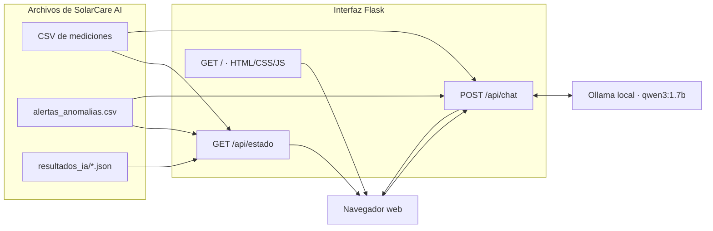

# Interfaz gráfica de SolarCare AI — Dashboard web Flask

> **Versión documentada:** interfaz `interfaz_solarcare_v2` publicada en la rama `feature/solarcare-python-dashboard`.  
> **Estado:** funcionamiento local observado en Ubuntu con CSV y resultados de pruebas; **despliegue en Raspberry Pi con Yocto pendiente de validación**.  
> **Alcance:** presentación, consultas de archivos locales y chat con Qwen3. Este componente **no sustituye** el monitoreo web existente del SESLAB ni controla dispositivos eléctricos.

## 1. Objetivo y decisiones de diseño

La interfaz de SolarCare AI proporciona un punto de consulta para visualizar las mediciones disponibles del inversor 2, identificar anomalías registradas y leer el análisis generado por Tev1 y Qwen3. Se añadió una conversación contextual para que el personal pueda preguntar por los datos asociados a un evento.

Se decidió utilizar **Flask** como servidor web ligero de Python y **HTML, CSS y JavaScript** para el cliente. Esta división permite conservar el detector como componente independiente: el navegador solicita información al servidor, y Flask lee los CSV/JSON generados por el sistema, **sin ejecutar nuevamente el algoritmo de detección ni modificar las mediciones originales**.

La versión 2 utiliza un diseño claro con tarjetas en tonos crema y verde oliva, una columna para el análisis y un panel de conversación. El estilo pretende facilitar la lectura de indicadores eléctricos y separar visualmente **medición, anomalía detectada e interpretación de IA**.

La interfaz constituye una **ampliación** de presentación respecto de la propuesta inicial; no debe confundirse con la aplicación web preexistente del SESLAB, cuya disponibilidad se contempla en RF-06/RF-07.

## 2. Estructura de archivos

| Archivo | Responsabilidad |
| --- | --- |
| [`app.py`](../software/interfaz_solarcare_v2/app.py) | Servidor Flask, lectura de CSV/alertas/resultados, preparación de datos para el navegador y consulta del chat a Ollama. |
| [`templates/index.html`](../software/interfaz_solarcare_v2/templates/index.html) | Estructura HTML del dashboard, indicadores, gráfica, historial, panel técnico y chat. |
| [`static/styles.css`](../software/interfaz_solarcare_v2/static/styles.css) | Apariencia visual, distribución adaptable a distintas pantallas y estilos de interacción. |
| [`static/app.js`](../software/interfaz_solarcare_v2/static/app.js) | Solicitudes al servidor, generación del gráfico SVG, selección de fecha y eventos, y mensajes del chat. |
| [`requirements.txt`](../software/interfaz_solarcare_v2/requirements.txt) | Dependencia de Flask: `Flask>=3.0,<4.0`. |
| [`README.md`](../software/interfaz_solarcare_v2/README.md) | Instrucciones de ejecución local de la interfaz. |

El frontend no requiere una biblioteca de gráficos externa: el JavaScript genera la curva de potencia mediante elementos **SVG**.

## 3. Arquitectura de presentación y flujo de datos



La imagen representa **relaciones lógicas**, no una validación de ejecución simultánea en Raspberry Pi. Las consultas HTTP del navegador se realizan a Flask; Flask resuelve la lectura local de archivos y la comunicación con Ollama.

## 4. Secciones de la pantalla

| Sección | Información mostrada | Origen |
| --- | --- | --- |
| Cabecera | Nombre SolarCare AI, inversor y estado de consulta de archivos | Respuesta del backend y estado de la página |
| Resumen de mediciones | Potencia AC de la última muestra (kW), tensión CC promedio (V), corriente CC promedio (A), energía estimada (kWh) | CSV seleccionado |
| Generación del inversor 2 | Serie temporal de potencia y señal visual de un evento seleccionado cuando está próximo a alguna muestra | Muestras CSV y evento activo |
| Historial de anomalías | Fecha, categoría, descripción breve, estado del análisis | CSV de alertas y resultados JSON |
| Estado de los datos | Fecha y hora de última medición disponible | CSV seleccionado |
| Diagnóstico inteligente | Evento seleccionado, duración reportada, puntuación Tev1, explicación, hipótesis y recomendación Qwen3 | Evento y resultado de IA |
| Mediciones por entrada CC | Corriente y tensión de las cuatro entradas, si existen | Última muestra del CSV |
| Asistente SolarCare AI | Preguntas y respuestas contextuales sobre un evento | Ollama/Qwen3, con datos verificados de archivos locales |

La navegación lateral enlaza secciones de una **misma página**, no módulos de adquisición o configuración independientes. La selección de un evento actualiza el detalle técnico, resalta la fila y, cuando corresponde, identifica la posición aproximada en la gráfica.

El historial presentado en pantalla está limitado por la implementación: el backend lee **hasta 200 alertas recientes** y el frontend muestra **hasta 30 eventos** de la fecha elegida. Esto no equivale a garantizar la visualización exhaustiva de todo el historial almacenado.

## 5. Funciones HTTP implementadas

| Método | Ruta | Entrada | Respuesta |
| --- | --- | --- | --- |
| `GET` | `/` | Ninguna | Plantilla HTML del dashboard. |
| `GET` | `/api/estado` | Parámetro opcional `fecha=YYYY-MM-DD` | JSON con mediciones, serie, alertas y estado de la información. |
| `POST` | `/api/chat` | JSON con `pregunta`, `id_evento` e `historial` opcional | JSON con respuesta de Qwen3 o código de error. |

El parámetro de fecha se valida con formato y calendario real. Una fecha inválida produce un error HTTP **400**.

El chat rechaza preguntas vacías o con más de **1200 caracteres**. Si Ollama no está disponible devuelve una respuesta de error, sin intentar modificar el CSV ni las alertas.

Estas rutas pertenecen a **SolarCare AI**, no representan los endpoints de la aplicación original del SESLAB.

## 6. Selección y tratamiento de las mediciones

### 6.1. Fuente de archivos

La interfaz admite dos formas principales de seleccionar las mediciones:

- `SOLARCARE_CSV`: ruta de un CSV concreto.
- `SOLARCARE_CSV_RAIZ`: raíz con subcarpetas diarias `YYYY-MM-DD/YYYY-MM-DD.csv`; tiene **prioridad** cuando está configurada y permite navegar por fechas.

El backend reutiliza la función `leer_csv()` del detector para validar mediciones y conservar las mismas convenciones de potencia, corriente, tensión y fecha. La lectura se realiza **sin escribir en el CSV original**.

Si se configura un **CSV único**, elegir una fecha distinta no busca automáticamente otro archivo: la interfaz filtra el contenido del mismo archivo. Para consultar varios días mediante el selector se debe configurar la **raíz diaria**.

### 6.2. Indicadores eléctricos

- **Potencia registrada:** potencia de la **última medición disponible** dividida entre 1000 para mostrar kW.
- **Tensión CC promedio:** media aritmética de las tensiones disponibles de las cuatro entradas.
- **Corriente CC promedio:** media aritmética de las cuatro corrientes.
- **Mediciones por entrada:** valores CC1 a CC4 de la última muestra.

Los promedios de entrada **no son** una estimación de potencia total del arreglo. Tampoco debe interpretarse cada entrada como un MPPT físico independiente sin confirmar la topología del equipo.

### 6.3. Energía estimada

El servidor aproxima la energía asociada a la serie de potencia mediante **integración trapezoidal** entre lecturas consecutivas:

```text
E_i [kWh] = (P_i + P_(i+1)) / 2  [kW] × Δt_i [h]
```

El algoritmo excluye de la integración intervalos de **más de 15 minutos** sin muestras consecutivas y señala la estimación como **parcial** si encuentra huecos de ese tipo. No interpola energía durante esos períodos.

**Interpretación:** se trata de una estimación a partir de muestras almacenadas; **no es una lectura certificada del medidor ni una factura eléctrica**.

### 6.4. Gráfica de potencia

El backend reduce la serie para visualización a un conjunto de aproximadamente **300 muestras**, agregando expresamente la última muestra cuando corresponde. Los cálculos de energía, en cambio, utilizan las mediciones completas que fueron leídas.

El navegador genera un gráfico SVG de potencia en kW contra tiempo. Un evento seleccionado puede señalarse si su marca temporal cae dentro de la serie graficada y existe una muestra suficientemente cercana (tolerancia de **15 minutos** en la ubicación del marcador).

El marcador es una referencia **visual aproximada** a una muestra, **no** una medición adicional ni una prueba de duración exacta de la falla.

## 7. Frecuencia de actualización y significado de «tiempo real»

El archivo [`static/app.js`](../software/interfaz_solarcare_v2/static/app.js) consulta `GET /api/estado` al iniciar la página y luego usa `setInterval(update, 25000)` para intentar una actualización **cada 25 segundos**.

Es fundamental distinguir tres escalas:

1. **Adquisición del SESLAB:** intervalo con que el sistema original genera las mediciones.
2. **Publicación de CSV:** retraso hasta que esas mediciones están disponibles en el archivo al que accede SolarCare AI.
3. **Refresco del navegador:** consulta del dashboard a Flask cada 25 segundos.

La actualización del navegador **no reduce** el retraso de adquisición/publicación de CSV ni confirma que el inversor esté operando en ese instante.

El equipo ya reportó acceso a archivos recientes de la máquina virtual con cierto *delay*, pero **no existe aún una medición documentada y reproducible de esa latencia**. La interfaz actual presenta explícitamente `CSV disponible · frescura no verificada` cuando puede leer un archivo válido; por tanto, el indicador es de **disponibilidad de archivo**, no de salud física del inversor ni de enlace en vivo verificado.

## 8. Historial y presentación de diagnósticos

Flask combina dos archivos independientes:

- `alertas_anomalias.csv`: aporta ID, categoría, inversor, marca temporal y contenido original del evento.
- `resultados_ia/<id_evento>.json`: aporta estado de IA, puntuación de Tev1, explicación, causas y recomendación de Qwen3.

Los eventos se filtran por la **fecha que se está visualizando**. La selección de un evento presenta la interpretación disponible; si aún no hay resultados, debe mostrarse un texto de indisponibilidad o estado pendiente.

La puntuación Tev1 se etiqueta como **«puntuación de revisión»**. No debe convertirse en una probabilidad de falla física ni en una severidad confirmada.

Para transitorios, cuando el dato incluye `duracion_tipo="cota_superior"`, la interfaz añade esa advertencia a la duración. Esto evita presentar la ventana temporal entre muestras como la duración exacta de la interrupción.

## 9. Chat contextual con Qwen3

El chat es una ampliación de interacción: el usuario pregunta por un evento mediante una solicitud a `POST /api/chat`. **No ejecuta el flujo automático Tev1 → Qwen3 del trabajador**, sino una llamada independiente de Flask al endpoint `/api/chat` de Ollama utilizando `qwen3:1.7b` por defecto.

### 9.1. Información enviada a Qwen3

El servidor prepara un contexto con:

- ID del evento seleccionado y metadatos de su categoría, fecha, inversor, duración y puntuación de revisión.
- Campos permitidos de la **evidencia original** registrada por el detector.
- Hasta tres muestras cercanas al evento tomadas del CSV correspondiente, cuando se encuentran dentro de las tolerancias temporales implementadas.
- Historial reciente de hasta **6 mensajes** recibido por el servidor.

Las interpretaciones generadas anteriormente **no se reutilizan como evidencia objetiva**. Si no hay datos comparables, el contexto lo indica explícitamente en lugar de inventar valores.

**Precaución técnica:** las instrucciones de seguridad y formato contenidas en el mensaje de sistema reducen el riesgo de afirmaciones infundadas, pero **no garantizan que Qwen3 jamás produzca una respuesta incorrecta**; debe ser revisada por personal técnico.

### 9.2. Parámetros de la conversación

| Ajuste | Valor publicado |
| --- | --- |
| Modelo | `qwen3:1.7b`, configurable con `SOLARCARE_CHAT_MODEL` |
| Servicio | Ollama local, configurable con `SOLARCARE_OLLAMA_URL` |
| `stream` | `false` |
| `think` | `false` |
| `temperature` | `0.2` |
| `num_predict` | `600` |
| `keep_alive` | `0` |
| Timeout HTTP de Flask a Ollama | 100 segundos |

En el navegador se mantiene el historial de conversación de la sesión de página; al cambiar de evento o de fecha se vacía el contexto que se enviará en las siguientes preguntas. No se encontró implementado almacenamiento persistente de conversaciones.

### 9.3. Limitaciones del chat

- No se conecta directamente al inversor y **no ejecuta comandos de operación o control**.
- No debe confirmar una causa física sin alarmas, irradiancia u otra evidencia independiente.
- No constituye una monitorización garantizada en tiempo real.
- Puede estar indisponible si el servicio Ollama o el modelo no están cargados.
- Se ha probado en Ubuntu, **no hay una evaluación cuantitativa de latencia del chat en Raspberry Pi**.

## 10. Modo de demostración y tratamiento de errores

Cuando **no existen alertas y no está configurado un CSV**, el backend puede devolver datos ilustrativos de un modo **DEMO**. Estos valores deben identificarse como tales: **no describen mediciones reales del SESLAB**.

Si se configura una ruta pero el archivo no existe o no puede leerse, el servidor informa el problema y la interfaz presenta una condición de **sin CSV disponible**; no debe asumir operación normal.

La interfaz diferencia tres situaciones:

| Situación | Significado |
| --- | --- |
| `modo="demo"` | Datos ilustrativos construidos para revisar el diseño de la página. |
| `modo="local"` y CSV válido | Registros disponibles en una fuente local o accesible como archivo; frescura **no verificada** por este endpoint. |
| Error o ausencia de archivo | No hay datos suficientes para presentar la medición solicitada. |

**Nota:** el dashboard no implementa por sí mismo una consulta HTTP de disponibilidad de la **aplicación web original** del SESLAB. Tampoco debe usarse el texto del encabezado como evidencia de una conexión en vivo.

## 11. Configuración y ejecución local en Ubuntu

### 11.1. Variables de configuración

| Variable | Finalidad | Valor por defecto en el código publicado |
| --- | --- | --- |
| `SOLARCARE_CSV` | Archivo CSV individual | No configurado |
| `SOLARCARE_CSV_RAIZ` | Carpeta raíz de archivos diarios | No configurada |
| `SOLARCARE_SALIDAS` | Directorio con alertas y resultados de IA | `PROJECT/salidas`, donde `PROJECT` es el directorio padre de la interfaz |
| `SOLARCARE_OLLAMA_URL` | Dirección de Ollama para el chat | `http://127.0.0.1:11434` |
| `SOLARCARE_CHAT_MODEL` | Modelo conversacional | `qwen3:1.7b` |
| `SOLARCARE_PORT` | Puerto del dashboard Flask | `8091` |

### 11.2. Ejecutar desde la estructura publicada en GitHub

**Diferencia entre la distribución original y la estructura nueva del repositorio:** la aplicación se probó inicialmente como `~/Ollama_proy/interfaz_solarcare_v2/`, con los módulos Python junto a la carpeta de interfaz. En GitHub los archivos están separados en:

```text
software/
  solarcare/
    detector_solarcare.py
    agente_solarcare.py
    salidas/                 # generada durante la ejecución
  interfaz_solarcare_v2/
    app.py
```

Por ello, **no basta con ejecutar el mismo comando de la carpeta original**: `app.py` agrega a la búsqueda de módulos el directorio `software/`, pero el importador necesita localizar `detector_solarcare.py` dentro de `software/solarcare/`. Asimismo, el directorio por defecto del dashboard para resultados es `software/salidas/`, mientras que el publicador utiliza por defecto `software/solarcare/salidas/`. Si no se configuran, la interfaz puede no encontrar las alertas aunque existan.

Como ejemplo local, desde la raíz del repositorio:

```bash
python3 -m pip install -r software/interfaz_solarcare_v2/requirements.txt

PYTHONPATH="$PWD/software/solarcare" \
SOLARCARE_SALIDAS="$PWD/software/solarcare/salidas" \
SOLARCARE_CSV="/ruta/autorizada/archivo_de_prueba.csv" \
python3 software/interfaz_solarcare_v2/app.py
```

**Antes de ejecutar** el ejemplo, sustituir la ruta del CSV por una fuente de prueba autorizada y usar el entorno virtual que contenga Flask. El comando es una **configuración propuesta para la nueva estructura**; no se presenta como una validación ya realizada.

El servidor integrado escucha en **`127.0.0.1:8091`** y se abre desde la misma computadora en `http://127.0.0.1:8091/`. Este enlace de loopback **no permite acceso remoto desde otro equipo** por sí solo.

### 11.3. Dependencias del despliegue

La interfaz declara Flask; el backend del chat hace peticiones HTTP a Ollama mediante la biblioteca estándar `urllib`. El detector Python debe estar importable al leer CSV; la instalación de Flask sola **no instala automáticamente el código de SolarCare AI ni los modelos de Ollama**.

## 12. Integración con Yocto y seguridad

En el estado de integración revisado, las recetas de Yocto instalan los programas del detector y los servicios de IA, pero **no consta todavía que instalen Flask, los archivos de interfaz y un servidor web adecuado para producción**.

Para completar el despliegue deben verificarse:

1. Inclusión del dashboard y sus dependencias en la imagen Linux.
2. Configuración de una **ruta de CSV autorizada y de solo lectura**, con las mismas convenciones del monitor.
3. Configuración de **un único directorio persistente de resultados** consumido por el dashboard.
4. Acceso a Ollama desde Flask sin exponer innecesariamente la API a otros equipos.
5. Servidor WSGI adecuado para despliegue y control de acceso a la interfaz.
6. Prueba desde un navegador externo a Raspberry Pi dentro de una red autorizada.
7. Medición de consumo de RAM, CPU y tiempo de respuesta mientras operan detector, modelos y dashboard.

El servidor de desarrollo Flask no debe exponerse públicamente. La interfaz actual no documenta autenticación propia de usuarios ni HTTPS; antes de acceso remoto se necesitan políticas de red, autenticación y despliegue adecuadas. No publicar direcciones IP internas ni credenciales en GitHub.

## 13. Evidencias, pruebas y criterios de aceptación

| Caso | Estado de evidencia |
| --- | --- |
| Página HTML y dashboard en Ubuntu | **Observado localmente** con datos de prueba y archivos históricos. |
| Visualización de mediciones y gráfica | **Observada localmente**; requiere prueba reproducible en la estructura reorganizada de GitHub y entorno final. |
| Historial de eventos e interpretación Tev1/Qwen3 | **Observado localmente**, con resultados generados por el flujo de prueba. |
| Chat contextual con Qwen3 | **Observado localmente**; conserva contexto del evento y gestiona respuestas o errores. |
| Acceso desde la red a CSV recientes de la VM del SESLAB | **Reportado por el equipo**; falta registrar procedimiento y latencias observadas. |
| Flask instalado y accesible en Raspberry Pi/Yocto | **Pendiente de demostrar**. |
| Dashboard enlazado al monitor automático y a los modelos en Raspberry Pi | **Pendiente de demostrar**. |
| Seguridad, sesiones, autenticación y servidor de producción | **Pendiente de definir y verificar**. |

Las **39 pruebas automatizadas aprobadas** corresponden al conjunto de detector, ausencia de datos e integración de cola en Ubuntu; **no hay en el conjunto publicado una batería de pruebas específica para rutas HTTP de Flask, renderizado de la interfaz o chat real en Raspberry Pi**.

Al cerrar la integración, registrar capturas de pantalla sin datos restringidos y pruebas de: selección de fecha, lectura de archivo faltante, caso DEMO, consulta de anomalía, respuesta de chat, Ollama apagado, persistencia de datos y acceso desde navegador autorizado.

## 14. Conclusión técnica

El dashboard Flask amplía SolarCare AI con una herramienta visual de inspección y consulta, manteniendo separadas las mediciones originales, las alertas del detector y las interpretaciones de IA. La presentación de valores, el marcado de transitorios como cotas superiores y el uso de evidencia original en el chat reducen ambigüedades frecuentes al analizar anomalías fotovoltaicas.

Los principales asuntos pendientes son **alinear las rutas tras la reorganización del repositorio, comprobar el funcionamiento integrado con los CSV reales del SESLAB y completar el despliegue seguro en Raspberry Pi con Yocto**. Hasta que existan pruebas de esa plataforma, la evidencia del dashboard se limita a Ubuntu.

**Documentación relacionada:** [Arquitectura](03_arquitectura_del_sistema.md) · [Detector](04_implementacion_del_detector.md) · [IA](05_integracion_inteligencia_artificial.md) · [Matriz de requerimientos](02_matriz_requerimientos.md).
