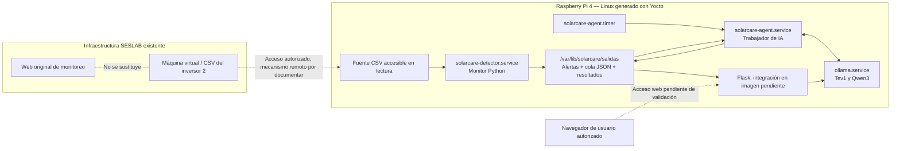

# Integración de SolarCare AI con Yocto Project y Raspberry Pi 4

> **Documento técnico, 11 de noviembre de 2026.** Esta descripción corresponde al código publicado en GitHub y al estado del desarrollo comunicado por el equipo, no a una certificación de funcionamiento en hardware.  
> **Fuentes de código revisadas:** rama `feature/solarcare-integracion` (commit `834b9ac`, 11 de noviembre de 2026); rama `feature/solarcare-python-dashboard` (software y documentación); y rama `main` (infraestructura Yocto inicial).  
> **Responsabilidad principal de implementación embebida:** integración Yocto y Raspberry Pi desarrollada por Verónica; documentación técnica y trazabilidad a cargo del equipo.  
> **Estado:** recetas, servicios y aplicación incluidos en distintas partes de la rama de integración; **compilación de imagen, arranque y flujo completo en Raspberry Pi pendientes de evidencia documentada**.

## Actualización de integración — 12 de noviembre de 2026

Según el reporte técnico compartido por el equipo, **la imagen Linux de Yocto ya se compiló y grabó en una microSD destinada a Raspberry Pi 4 (8 GB RAM)**. Se comunicó asimismo una inspección del sistema de archivos preparado en la microSD que confirmó la presencia del módulo de kernel **CIFS** y de **cifs-utils 7.4**, incluida la herramienta `mount.cifs`. Esta información constituye un **avance reportado de preparación de imagen y dependencias**, no una prueba de ejecución de la Raspberry Pi.

Para acceder a las mediciones, el equipo definió una **carpeta SMB 3 del servidor Windows del SESLAB**; se proyecta montarla en modo **solo lectura** y utilizar la subcarpeta correspondiente al inversor 2. **Todavía no está demostrado** que la Raspberry Pi pueda alcanzar el servidor, autenticar y montar ese recurso, localizar los CSV esperados ni procesarlos automáticamente.

**Evidencias por incorporar:** versión/commit de la compilación, salida final de BitBake, nombre y suma de comprobación de la imagen, registro de grabación, evidencia de paquetes inspeccionados y prueba posterior de arranque y montaje autorizado. **No incluir** direcciones IP privadas, nombres de cuenta, credenciales, rutas de red internas o información institucional de acceso en este repositorio público.

**Incompatibilidad de rutas por comprobar:** el monitor espera `<raiz>/YYYY-MM-DD/YYYY-MM-DD.csv`, pero algunos históricos están organizados por **mes**. Antes de habilitar la supervisión continua se debe inspeccionar la estructura accesible desde Raspberry Pi y, si corresponde, ajustar el origen lógico de los CSV. El montaje SMB en sí **no garantiza** que el monitor encuentre archivos.

## 1. Objetivo de la integración

La finalidad de Yocto Project en SolarCare AI es generar una distribución Linux adaptada a Raspberry Pi 4 que pueda ejecutar los componentes del sistema de forma coordinada: lectura de archivos CSV del SESLAB, detección determinista de anomalías, persistencia de alertas, procesamiento local con Tev1 y Qwen3 mediante Ollama y visualización de resultados.

La arquitectura mantiene el **sistema de adquisición y la aplicación web existentes del SESLAB**. SolarCare AI debe leer sus archivos con autorización, sin modificarlos, y producir resultados propios. La integración embebida no requiere intervenir directamente sobre los inversores.

Se utiliza `systemd` para gestionar servicios y un temporizador del trabajador de IA. Esto permite separar el ciclo continuo del detector de las inferencias, que pueden ser más lentas y consumir más recursos.

### 1.1. Vista de despliegue prevista



**Nota:** todas las flechas de la Raspberry Pi son **relaciones de diseño/configuración**; no representan una prueba integral ya realizada en el dispositivo.

## 2. Organización de la capa `meta-solarcare`

La rama de integración contiene la capa `yocto/meta-solarcare/` con los siguientes componentes:

```text
yocto/meta-solarcare/
├── conf/
│   └── layer.conf
├── recipes-core/
│   ├── images/
│   │   └── solarcare-image.bb
│   └── solarcare-storage/
│       ├── solarcare-storage_1.0.bb
│       └── files/
│           ├── solarcare-expand-rootfs.sh
│           └── solarcare-expand-rootfs.service
├── recipes-ai/
│   └── ollama/
│       ├── ollama_0.40.13.bb
│       └── files/
│           └── ollama.service
└── recipes-apps/
    └── solarcare/
        ├── solarcare_1.0.bb
        └── files/
            ├── app/        # 10 módulos Python en la rama de integración
            └── services/
                ├── solarcare-detector.service
                ├── solarcare-agent.service
                └── solarcare-agent.timer
```

El archivo [`layer.conf`](https://github.com/VeroC25/Project_2_Embebidos/blob/feature/solarcare-integracion/yocto/meta-solarcare/conf/layer.conf) registra `meta-solarcare` como colección BitBake, define prioridad `6`, dependencia de la capa `core` y compatibilidad de serie declarada como `wrynose`. La validez de esa compatibilidad debe comprobarse **contra la versión concreta de Yocto instalada en el entorno de compilación**.

El [`README` de la capa](https://github.com/VeroC25/Project_2_Embebidos/blob/feature/solarcare-integracion/yocto/meta-solarcare/README) todavía conserva secciones genéricas de plantilla; debe sustituirse por instrucciones reales de capas, máquina objetivo, dependencias y procedimiento de construcción.

## 3. Imagen Linux personalizada

La receta [`solarcare-image.bb`](https://github.com/VeroC25/Project_2_Embebidos/blob/feature/solarcare-integracion/yocto/meta-solarcare/recipes-core/images/solarcare-image.bb) parte de `core-image-base.bb` y añade paquetes a `IMAGE_INSTALL`:

| Paquete o grupo | Función prevista |
| --- | --- |
| `python3`, `python3-core`, `python3-modules` | Entorno de ejecución de scripts Python. |
| `openssh` | Acceso remoto de administración autorizado. |
| `solarcare` | Aplicación del detector y trabajador, empaquetada por una receta propia. |
| `ollama` | Servidor local de inferencia. |
| `solarcare-storage` | Herramienta de ampliación del sistema de archivos raíz. |
| `parted`, `e2fsprogs-resize2fs`, `util-linux-findmnt` | Herramientas utilizadas por el procedimiento de expansión del almacenamiento. |

La receta también declara `IMAGE_ROOTFS_EXTRA_SPACE = "1048576"`, reserva adicional de espacio del sistema de archivos raíz **durante la generación de imagen**; no equivale a una ampliación automática de la partición al tamaño completo de la microSD.

**No se encontró `Flask` ni un servidor WSGI añadido expresamente a esta lista.** La interfaz está subida a la rama de integración, pero se debe incorporar al empaquetado de la imagen para ejecutarla en Raspberry Pi.

### 3.1. Condiciones para reproducir la imagen

Para un resultado reproducible se necesita documentar, como mínimo:

- Distribución/versión exacta de Yocto y de las capas requeridas.
- Valor de `MACHINE` para Raspberry Pi 4 y contenido relevante de `bblayers.conf` y `local.conf` **sin secretos**.
- Origen y versión de las recetas de la imagen y de los ejecutables externos.
- Comando de compilación y resultado observado.
- Nombre, tamaño, tipo y comprobación de integridad del artefacto de imagen obtenido.

El comando previsto en un entorno Yocto configurado es `bitbake solarcare-image`. **El equipo reportó la compilación finalizada y la imagen grabada en microSD; todavía no hay log de compilación, hash o archivo de salida adjuntados en GitHub para verificarla independientemente**.

## 4. Receta de Ollama y servicio de inferencia

La receta [`ollama_0.40.13.bb`](https://github.com/VeroC25/Project_2_Embebidos/blob/feature/solarcare-integracion/yocto/meta-solarcare/recipes-ai/ollama/ollama_0.40.13.bb) está diseñada para incorporar **ejecutables precompilados ARM64**, en lugar de compilar el motor de Ollama desde sus fuentes. Su `SRC_URI` contiene:

```bitbake
SRC_URI = "file://ollama-cpu file://ollama.service"
```

La receta instala el ejecutable `ollama` y sus bibliotecas compartidas en ubicaciones de sistema, añade el servicio `systemd`, prepara el directorio de modelos y define un usuario de sistema `ollama`.

**Punto de reproducibilidad:** el directorio de binarios `ollama-cpu` **no aparece en el árbol Git publicado que se revisó**. Por tanto, debe verificarse dónde está disponible el artefacto y cómo lo incorpora el entorno de construcción antes de afirmar que basta clonar el repositorio para construir la receta.

### 4.1. Servicio `ollama.service`

La unidad [`ollama.service`](https://github.com/VeroC25/Project_2_Embebidos/blob/feature/solarcare-integracion/yocto/meta-solarcare/recipes-ai/ollama/files/ollama.service) establece:

| Configuración | Valor o comportamiento previsto |
| --- | --- |
| Comando | `/usr/bin/ollama serve` |
| Usuario/grupo | `ollama` |
| Dirección del servidor | `OLLAMA_HOST=127.0.0.1:11434` |
| Carpeta de modelos | `OLLAMA_MODELS=/var/lib/ollama/models` |
| Bibliotecas | `LD_LIBRARY_PATH=/usr/lib/ollama` |
| Recuperación | `Restart=on-failure`, después de 10 segundos |
| Habilitación en receta | `SYSTEMD_AUTO_ENABLE = "enable"` |

El enlace a la dirección de loopback favorece que el detector, agente y Flask consulten a Ollama **en el mismo equipo** sin exponer directamente su API a la red.

Los modelos `tev1:0.8b` y `qwen3:1.7b` **no están incluidos en Git**. Falta documentar su instalación, disponibilidad real, compatibilidad y consumo de recursos dentro de la Raspberry Pi.

Además de Ollama como servicio, el [agente Python](../software/solarcare/agente_solarcare.py) utiliza `from ollama import Client`: debe comprobarse la presencia del **paquete Python cliente `ollama`** en el entorno embebido. La receta de la aplicación revisada declara Python, pero no esa dependencia explícita.

## 5. Empaquetado de la aplicación SolarCare

La receta [`solarcare_1.0.bb`](https://github.com/VeroC25/Project_2_Embebidos/blob/feature/solarcare-integracion/yocto/meta-solarcare/recipes-apps/solarcare/solarcare_1.0.bb) contempla:

1. Incorporación de los archivos `*.py` preparados bajo `files/app/`.
2. Instalación de scripts en `/opt/solarcare/`.
3. Creación de `/var/lib/solarcare/salidas/` para resultados persistentes.
4. Enlace simbólico `/opt/solarcare/salidas` hacia ese directorio.
5. Instalación de las unidades `systemd` del detector y de la IA.

La receta declara como dependencias `python3-core python3-modules`. No incluye expresamente los archivos HTML/CSS/JS de Flask en `SRC_URI` ni una unidad `systemd` para servir la interfaz.

### 5.1. Organización de código en la rama de integración

La rama de Verónica contiene **dos ubicaciones relacionadas**:

- `solarcare/`: programas Python e `interfaz_solarcare_v2/`, incorporados al árbol de trabajo para la integración.
- `yocto/meta-solarcare/recipes-apps/solarcare/files/app/`: copia de diez programas Python utilizada como origen de la receta de instalación.

Esto es una mejora con respecto al estado inicial: la **interfaz Flask y el chat ya aparecen en la rama de integración** (commit `834b9ac`). Sin embargo, no se observa que la receta esté instalando aún esa carpeta ni que mantenga automáticamente sincronizadas las dos copias de los programas Python.

**Riesgo para el mantenimiento:** si se edita `solarcare/` y no se actualiza `files/app/`, el código desplegado en la imagen puede diferir del código revisado en GitHub. Antes de cerrar la entrega debe definirse una **fuente única de verdad** para el empaquetado.

## 6. Servicios `systemd` de SolarCare AI

La arquitectura separa el monitor permanente del trabajador de inferencia activado periódicamente.

| Servicio | Tipo | Configuración implementada en la rama |
| --- | --- | --- |
| [`solarcare-detector.service`](https://github.com/VeroC25/Project_2_Embebidos/blob/feature/solarcare-integracion/yocto/meta-solarcare/recipes-apps/solarcare/files/services/solarcare-detector.service) | `simple` | Monitor diario continuo, consulta cada 10 segundos, comprobación de ausencia de datos y publicación de eventos. Reinicio automático ante fallas con espera de 5 segundos. |
| [`solarcare-agent.service`](https://github.com/VeroC25/Project_2_Embebidos/blob/feature/solarcare-integracion/yocto/meta-solarcare/recipes-apps/solarcare/files/services/solarcare-agent.service) | `oneshot` | Ejecuta una pasada de `trabajador_ia.py`, conservando logs en journal y resultados en disco. |
| [`solarcare-agent.timer`](https://github.com/VeroC25/Project_2_Embebidos/blob/feature/solarcare-integracion/yocto/meta-solarcare/recipes-apps/solarcare/files/services/solarcare-agent.timer) | `timer` | Activa el trabajador 60 segundos después del arranque y 60 segundos después de que finalice una ejecución anterior. |

### 6.1. Configuración del monitor

La unidad del detector especifica el directorio de trabajo `/opt/solarcare` y los argumentos:

```text
--raiz "/var/lib/solarcare/datos/Inversor 2"
--continuo --intervalo 10
--verificar-datos --publicar-estados
--seguimiento-estado --publicar-electricas
--salidas /var/lib/solarcare/salidas
```

Esto representa **un ciclo de consulta cada 10 segundos**, no una frecuencia de adquisición de los inversores ni la latencia real de los archivos del SESLAB. La ruta de origen es una **ruta esperada en Raspberry Pi**; el código publicado no incluye todavía el mecanismo que la conecta con la carpeta remota de la máquina virtual.

La variable `TZ=CST6` fija una zona horaria de operación; deberá verificarse que las marcas de los CSV, el reloj del sistema y las fechas registradas por los servicios resulten compatibles.

### 6.2. Configuración del trabajador

La unidad del trabajador indica `Wants=ollama.service` y `After=ollama.service`. Esto establece una relación de arranque y orden, **pero no demuestra que Ollama ya tenga los modelos cargados ni que esté listo para responder** cuando se ejecute el primer trabajo.

El temporizador utiliza `OnBootSec=60s` y `OnUnitInactiveSec=60s`, por lo que no conviene describirlo como una tarea estrictamente programada a un instante fijo del reloj; su cadencia depende también de cuánto dure cada procesamiento de IA.

### 6.3. Estado de habilitación

En la receta de aplicación se encuentra:

```bitbake
SYSTEMD_AUTO_ENABLE = "disable"
```

Por ello, aunque las unidades se instalen, **no debe asumirse que el monitor y el temporizador quedarán habilitados automáticamente tras el arranque**. Corresponde a la integración definir y demostrar cómo se activarán durante operación y evaluación.

El servidor `ollama.service`, en cambio, tiene habilitación configurada como `enable` en su receta.

## 7. Persistencia de datos y estructura de directorios

La configuración publicada prevé las siguientes rutas:

| Ruta en Raspberry Pi | Uso previsto | Estado de verificación |
| --- | --- | --- |
| `/opt/solarcare/` | Módulos Python de la aplicación | Instalación descrita en receta; verificar imagen ejecutable. |
| `/var/lib/solarcare/datos/Inversor 2/` | Raíz lógica de los CSV diarios accesibles | **Falta documentar acceso o montaje autorizado desde la VM**. |
| `/var/lib/solarcare/salidas/` | Alertas, cola de IA, resultados y estados | Preparada por la receta; verificar permisos, persistencia y capacidad. |
| `/opt/solarcare/salidas` | Enlace al almacenamiento persistente | Definido en receta. |
| `/var/lib/ollama/models` | Archivos de modelos Ollama | Directorio definido en receta; modelos deben instalarse aparte. |

La separación de la fuente y los resultados responde a la restricción de **no modificar los CSV originales** del SESLAB.

Dado que ya se obtuvo conectividad con la máquina virtual y se observaron CSV recientes con retraso, el siguiente paso de documentación es registrar **el protocolo autorizado de acceso, el equipo desde el cual se probó, la ruta lógica y la latencia medida**, sin publicar IP privadas, cuentas ni credenciales.

## 8. Gestión de almacenamiento en microSD

La receta [`solarcare-storage_1.0.bb`](https://github.com/VeroC25/Project_2_Embebidos/blob/feature/solarcare-integracion/yocto/meta-solarcare/recipes-core/solarcare-storage/solarcare-storage_1.0.bb) instala un script de expansión y una unidad `systemd` que se encuentra **deshabilitada por defecto**.

El script [`solarcare-expand-rootfs.sh`](https://github.com/VeroC25/Project_2_Embebidos/blob/feature/solarcare-integracion/yocto/meta-solarcare/recipes-core/solarcare-storage/files/solarcare-expand-rootfs.sh) está diseñado específicamente para:

- Identificar la microSD como `/dev/mmcblk0`.
- Trabajar con la partición `/dev/mmcblk0p2` **solo cuando coincide con la raíz montada**.
- Comprobar la tabla de particiones y la relación entre el kernel y el tamaño registrado.
- Ampliar la segunda partición cuando corresponda y, tras reconocer la nueva tabla, ampliar el sistema de archivos **ext4** mediante `resize2fs`.

Se trata de una operación **potencialmente destructiva si se ejecuta en un dispositivo o partición incorrectos**. No debe activarse automáticamente ni probarse sin confirmar respaldo de la microSD, dispositivo de arranque, distribución de particiones y procedimiento de recuperación.

**Estado:** se encontró el mecanismo en código; no se dispone de evidencia de su ejecución exitosa ni del espacio final disponible en Raspberry Pi.

## 9. Estado de la interfaz Flask dentro del despliegue

La rama `feature/solarcare-integracion` añadió la carpeta `solarcare/interfaz_solarcare_v2/`, que incluye el servidor Flask, la plantilla HTML, los archivos estáticos, dependencias y chat con Qwen3.

Sin embargo:

1. La receta `solarcare_1.0.bb` copia `*.py` desde `files/app/` y **no instala** de manera explícita la estructura `templates/` y `static/` del dashboard.
2. La imagen `solarcare-image.bb` **no añade expresamente Flask**.
3. No se observa una unidad web de `systemd` ni una configuración de servidor WSGI para desplegar la interfaz.
4. El `app.py` original de nuestra rama usa una dirección de loopback para pruebas locales; para servir a otros equipos debe configurarse un acceso web controlado, con medidas de seguridad apropiadas.

Por tanto, **«Flask incorporado al repositorio» y «Flask ejecutándose en la imagen final» son estados diferentes**. El primer hecho está respaldado por GitHub; el segundo permanece pendiente de evidencia.

Además, las rutas configuradas del monitor, la publicación de alertas y Flask deben apuntar a **un directorio coherente de resultados**, para evitar que el dashboard muestre archivos antiguos o vacíos mientras el detector guarda alertas en otra ruta.

## 10. Dependencias y riesgos de integración detectados

Esta sección recoge **aspectos que deben verificarse**, no defectos demostrados de la imagen en ejecución.

| Riesgo / dependencia | Evidencia en código | Verificación recomendada |
| --- | --- | --- |
| Binarios ARM64 de Ollama fuera del árbol Git revisado | `SRC_URI` solicita `ollama-cpu`; no aparece publicado en el árbol | Confirmar origen, versión, ubicación y licencia de distribución del binario usado para compilar. |
| Paquete Python cliente de Ollama | El agente usa `from ollama import Client`; receta SolarCare declara Python básico | Confirmar dependencia y que la importación funciona en Raspberry Pi. |
| Modelos ausentes del repositorio | Pesos de Tev1 y Qwen3 no publicados | Definir instalación reproducible y comprobar inferencia local sin Internet. |
| Servicios SolarCare deshabilitados por defecto | `SYSTEMD_AUTO_ENABLE="disable"` | Definir activación operativa, arranque tras reinicio y registro de evidencias. |
| Acceso remoto a los CSV no automatizado en receta | Monitor usa raíz bajo `/var/lib/solarcare/datos` | Mostrar mecanismo autorizado de lectura, montaje y recuperación de red. |
| Duplicidad de scripts en Git | `solarcare/` y `files/app/` | Sincronizar o definir origen único de la versión instalada. |
| Falta empaquetar dashboard | Archivos Flask en `solarcare/interfaz_solarcare_v2/` pero no en receta | Instalar paquete web, plantillas y estáticos; configurar servicio y permisos. |
| Recursos limitados en Raspberry Pi 4 | Dos modelos solicitados en secuencia | Medir RAM, CPU, uso de microSD, tiempo de inferencia y tiempos del detector. |
| Expansión de particiones | Script dirigido a `mmcblk0p2` | Validar distribución real, respaldar microSD y probar procedimiento de forma controlada. |
| Disponibilidad web SESLAB (RF-06/RF-07) | La IA conoce el tipo de evento, pero falta monitor HTTP | Implementar y ensayar detección de caída de la web con CSV actualizados. |

## 11. Plan de validación y evidencias para el repositorio

La validación de Yocto debe documentar **lo ejecutado realmente**, diferenciando inspecciones de configuración, compilación, arranque y operación integrada.

### 11.1. Verificación de compilación y despliegue

| ID | Prueba de aceptación | Evidencia que debe incorporarse | Estado |
| --- | --- | --- | --- |
| Y-01 | La capa `meta-solarcare` se reconoce en la compilación | Lista de capas, versión de Yocto y `MACHINE` | Pendiente de adjuntar |
| Y-02 | La imagen `solarcare-image` compila correctamente | Log o resumen de BitBake, archivo de salida y checksum | **Compilación y grabación reportadas (12/11); evidencia formal pendiente de adjuntar** |
| Y-03 | La Raspberry Pi inicia la imagen construida | Captura/log de arranque, identificación del sistema y kernel | Pendiente de adjuntar |
| Y-04 | Ollama está disponible en loopback | Estado de `ollama.service` y respuesta al servicio | Pendiente de adjuntar |
| Y-05 | Tev1 y Qwen3 responden en Raspberry Pi | Logs de inferencia con versión, tiempos y recursos | Pendiente de adjuntar |
| Y-06 | El monitor encuentra CSV recientes de la VM | Ruta autorizada, horario de lectura y diferencia de tiempos observada | Pendiente de adjuntar |
| Y-07 | El detector produce una alerta y la registra | Comando/servicio, categoría, archivo de salida y caso de prueba | Pendiente de adjuntar |
| Y-08 | El trabajador procesa la cola | JSON de resultado y trazabilidad con `id_evento` | Pendiente de adjuntar |
| Y-09 | Con Ollama detenido, el detector sigue operativo | Alerta persistente, cola retenida y reintento tras restaurar IA | Pendiente de adjuntar |
| Y-10 | Flask muestra los registros y el análisis desde un navegador autorizado | Evidencia de servidor, ruta web y consulta sobre un evento | Pendiente de adjuntar |
| Y-11 | Datos y eventos sobreviven a un reinicio | Archivos persistentes antes/después y estado de servicios | Pendiente de adjuntar |
| Y-12 | Se verifica el uso de RAM, CPU, disco y latencia | Tabla de recursos por componente y en operación conjunta | Pendiente de adjuntar |

No se incluye en Git ningún dato institucional no autorizado ni información de acceso de la red.

### 11.2. Comandos de observación previstos para Raspberry Pi

Los siguientes comandos son **propuestas de diagnóstico**, no resultados ya obtenidos. Su uso depende de que el equipo haya instalado y habilitado las unidades:

```bash
systemctl status ollama.service --no-pager
systemctl status solarcare-detector.service --no-pager
systemctl status solarcare-agent.timer --no-pager
systemctl list-timers --all
journalctl -u solarcare-detector.service -n 50 --no-pager
journalctl -u solarcare-agent.service -n 50 --no-pager
findmnt /var/lib/solarcare/datos
df -h
free -h
```

Para cada prueba se recomienda registrar **fecha, versión de la imagen, commit, equipo, comando, resultado esperado, resultado observado y captura o log**. No se deben publicar archivos completos de producción si contienen información interna del SESLAB.

## 12. Correspondencia con la propuesta original

| Elemento del diseño | Avance documentado | Evidencia final pendiente |
| --- | --- | --- |
| Plataforma embebida con Linux generado por Yocto | Capa, recetas e imagen definidas en GitHub | Compilación, arranque y funcionalidad en Raspberry Pi |
| Supervisión de CSV sin alterar el sistema existente | Detector Python implementado; equipo reporta acceso a la VM | Montaje/lectura automática de datos desde Raspberry Pi y verificación de solo lectura |
| Detector independiente de IA (RNF-06) | Arquitectura por archivos y trabajador con reintentos | Prueba integral con Ollama detenido |
| Inferencia local (RNF-07) | Tev1 y Qwen3 utilizados en Ubuntu; receta Ollama preparada | Ejecución y evidencia en Raspberry Pi sin Internet |
| Adecuación a recursos (RNF-08) | Diseño secuencial y almacenamiento previsto | Medición de RAM, CPU, tiempos y espacio |
| Interfaz de visualización complementaria | Flask y chat incorporados a la rama de integración | Empaquetado, servicio seguro y prueba desde navegador |

Para el estado pormenorizado de los requisitos RF/RNF, consultar [matriz de trazabilidad](02_matriz_requerimientos.md).

## 13. Conclusión

El repositorio refleja una **arquitectura de integración Yocto coherente con la propuesta**: imagen propia, recetas para aplicación y Ollama, servicios de supervisión y procesamiento separados, almacenamiento persistente y mecanismo para administrar el espacio de la microSD.

El avance más reciente de Verónica también incorpora la **interfaz Flask y el chat al árbol de integración**. Esto facilita completar el sistema, aunque todavía hace falta incluir esos archivos en el paquete instalado y demostrar su funcionamiento en Raspberry Pi.

El cierre técnico de esta fase depende de **evidencia reproducible de compilación, ejecución de modelos, acceso remoto autorizado a CSV y funcionamiento extremo a extremo**. Hasta entonces, el trabajo se documenta como **preparación e integración en curso**, sin atribuir pruebas de hardware que no se han recibido.

**Documentación relacionada:** [Arquitectura](03_arquitectura_del_sistema.md) · [Detector](04_implementacion_del_detector.md) · [IA](05_integracion_inteligencia_artificial.md) · [Interfaz](06_interfaz_grafica.md) · [Índice](README.md).
